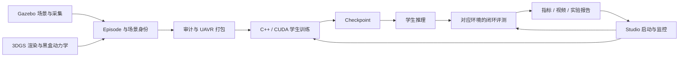

# code 目录代码审计、交接评估与下一阶段实施建议（详细版）

- 日期：2026-11-05，Asia/Shanghai。
- 范围：`code/uav_rgb` 主线；`code/ALVLN` 镜像与冻结管理台；`code/CF-Drone` 相关安全控制路径。
- 快照：主线 `9d764d9`，镜像 `1786e9b`。审计开始后有其他会话提交交接文档，结论以这两个较新的快照为准。
- 方法：四个主审计 agent 并行检查文档、训练评测、仿真飞控、运行交付；主代理交叉核对源码、数据产物和测试。部分审计线进一步做了并行只读复核。
- 交付：只新增本报告、验证记录、过程记录；没有修复下述代码，没有提交或推送。
- 详细版更新：2026-11-05；在同一报告中补充工程地图、证据等级、交接矩阵、修复工作包、指标合同建议及验收清单，不重复发起审计或声称新增实测。

## 如何阅读这份文档

这份文档服务于两件事：决定接下来最值得投入的方向，以及让下一位开发者能明确接手。正文中的“已核实”是本轮审计证据；“建议／待实施”是后续方案，尚未写入业务代码。

| 读者／用途 | 建议阅读顺序 |
| --- | --- |
| 项目负责人，决定下一阶段 | 结论先行 → 已核实的当前事实 → [路线选择与投入顺序](#direction-details) |
| 开发者，准备修复 | 原有问题 1–20 → [证据等级与修复批次](#evidence-and-batches) → [负例验收矩阵](#regression-matrix) |
| 接手者，恢复项目上下文 | [工程地图与能力边界](#project-map) → [交接文档整改矩阵](#handoff-matrix) → [接手执行清单](#handoff-checklist) |
| 复核者，检查结论可靠性 | [验证记录](experiments/2026-11-05-audit-validation.md) → 未检查范围与风险 → [证据等级](#evidence-and-batches) |

问题编号 1–20 在本次扩写中保持不变。P1/P2 表示整改优先级，不表示所有问题已经在真实设备或完整运行环境中复现。

## 结论先行

项目已经有可工作的单机研究管线：自研 C++/CUDA 四动作学生、数据打包、Gazebo 闭环、3DGS 在线渲染接入、桌面监控和录像。假定负载为一台研究服务器、多个实验和可能并行的本地桌面会话，不按公网多租户产品评判。

当前主要短板是**数据、仿真、评测和记录尚不能共同构成可信的能力证据**。25 项 CTest 全过，不能覆盖重复验证集、碰撞穿透、失败计成功、异步归档串实验等问题。现在扩大模型或训练预算，容易得到无法解释的数字。

建议下一阶段命名为：**可信四动作闭环基线 v1**。先修复实验有效性，再用同一组冻结任务比较 student / forward / teacher。之后优先研究闭环失败状态的教师纠偏数据；GRU 和 RL 等基线与失败证据足以支持时再立项。

## 已核实的当前事实

| 项 | 本轮证据 | 能说明什么 |
| --- | --- | --- |
| C++/CUDA | 25/25 CTest 通过，186.52 秒；Ninja dry-run 无待构建项 | 现有构建的注册测试通过；不是全场景导航能力证明 |
| Python 主检查 | `tools/check.sh --python-only` 退出 0 | 数据门禁、工具及 UI 现有检查通过 |
| 新模块补充 | UART、splat 转换、RL core 检查通过；子代理 15 项 3DGS CPU/mock 检查通过 | 只覆盖已执行的用例，不含本轮发现的全部边界 |
| Gazebo 校园结果 | 既有 `campus-paired-20261103/eval-cl-full/eval.json`：80 集完成、0 集成功、4 集碰撞、10 个 geometry_gid | 是需要正视的已有闭环失败证据；本轮读取核对，未重跑这 80 集 |
| 3DGS 校园样例 | train/val 各 10 张 PNG，逐张完全相同；打包后的两份 RGB 数据块也相同；两侧标签均为 10 个 FORWARD | 只适合链路冒烟，不能评估泛化或四动作能力 |
| 3DGS 成功视频 | 同一 checkpoint、相同 12 个 FORWARD、相同终点；目标 x 从 -6 调到 -7、再到 -7.5，结果才由失败变成功 | 可说明调整后任务有成功样例，不能说明模型改进 |
| 本地镜像 | 审计快照下，排除构建、环境和缓存后，主线与镜像内容一致 | 根 README 中“旧快照落后 78 处”不再是当前事实 |
| 飞控工作树 | 大量既有修改，但 `git diff --ignore-space-at-eol --stat` 为空 | 当前差异表现为行尾，不应误认本轮修改或新增飞控功能 |

所有新验证的命令、结果和范围见 [验证记录](experiments/2026-11-05-audit-validation.md)。

## 必须优先处理

P1 指会污染正式实验、阻断标准交付，或在明确启用的硬件路径中影响安全。固件两项是条件性源码发现，不代表已刷入设备存在实测故障。

### 1. P1：3DGS 重复场景跨 train/val 仍被放行

- **位置／作用：** `sim/3dgs/collect_3dgs.py:244,343` 以 seed 设置 scene_id、写空 geometry_gid；`tools/preprocess.py:270` 及 `src/dataset.cpp:186` 据此划分数据；`src/trainer.cpp:546` 使用 val 选 best。
- **触发／证据：** Callinstrasse pilot 的 scene_id 为 0/1，但 PLY、scene.json 指纹相同，10/10 PNG 与标签相同；实际 `scan()` 放行，既有 UAVR 的 train/val RGB 块也相同。
- **最小修复：** 为 3DGS 定义与 seed 无关的稳定场景身份，按场景分组划分；正式数据缺身份应拒绝。同 PLY、不同 seed、跨 split 必须有拒绝测试。
- **不修后果：** 训练副本参与选模，验证指标不能解释为未见数据上的效果。当前单场景数据只能继续标为 smoke。

### 2. P1：渲染与碰撞使用不同坐标系

- **位置／作用：** `sim/3dgs/scene.py:250` 用 nav_to_world 变换相机；`sim/3dgs/collision.py:112` 直接用原始 PLY means 建导航占据。
- **触发／证据：** 非单位变换时出错。内存复现把世界平移 10 m，相机前方 1 m 的障碍在导航 x=1 查询无碰撞，x=11 才有碰撞。
- **最小修复：** 明确刚体变换、尺度和地面约定，先把 PLY 点变回导航坐标再切片建占据；增加平移和旋转一致性测试。
- **不修后果：** 换真实场景后，视觉中的障碍与碰撞位置错开。这不是已声明的点云稀疏近似误差。

### 3. P1：碰撞只查动作终点，能够穿过已占据障碍

- **位置／作用：** `sim/3dgs/collect_3dgs.py:172` 先推进完整动作窗口，再在终点调用 collides。
- **触发／证据：** 真实 run_episode 的内存复现：hold=0.5 s、voxel=0.1 m、inflate=0.15 m；轨迹由 x=0.839960 到 1.388678，越过 x=1.05 的占据点，却全部记录 collision=false。
- **最小修复：** 在动力学子步或保守扫掠路径上累计碰撞；第一次接触即终止，不能仅检查终点。
- **不修后果：** 低估碰撞率，stop_on_collision 也无法阻止这类穿透。

### 4. P1：采集返回错误后仍可记成功并退出 0

- **位置／作用：** `sim/3dgs/collect_3dgs.py:234` 把复制场景失败放入返回的 err；`sim/3dgs/eval_3dgs.py:107,119,203` 未据 err 拒绝有效集。
- **触发／证据：** 注入 scene.json 复制失败，实际输出 exit_code=0、physics_verified=false、collect_error 非空，同时 episodes_done=1、failed_count=0、success_rate=1.0。
- **最小修复：** 汇总前检查 err 和本任务要求的 manifest 有效性；不完整集进入 failed，退出码检查失败状态。用渲染、推理和落盘故障注入验证。
- **不修后果：** 缺乏完整追溯资料的结果仍被当作有效成功；自动化调用也看不到失败。

### 5. P1：Studio 的异步评测结果会归档到另一实验

- **位置／作用：** `ui/studio.py:2376` 启动评测，`:2865` 可切换 run，`:2975` 处理结束，`:2457` 却向当前 self.run_dir 写摘要。
- **触发／证据：** A 评测运行时加载或开始训练 B。内存调用实际方法，A 的 checkpoint、评测与视频挂到 B；B 没摘要时还被填成 finished / return_code=0，即使 B 仍在训练。
- **最小修复：** 评测启动时固定所属 run；归档及错误备注使用该 run，自身元数据也从该 run 读取。补切换 run 和启动新训练两条测试。
- **不修后果：** 训练、权重和评测失去对应关系，实验报告可直接给出错误归因。

### 6. P1：标准构建和推荐训练 CLI 使用不同默认目录

- **位置／作用：** `tools/check.sh:6` 默认 build/check；`tools/train_student_with_video.py:218` 默认 src/build；env.sh 未统一覆盖。
- **触发／证据：** 干净交付只按标准检查构建后，推荐 CLI 找不到 src/build/uavrgb_train 并返回 2；旧机器若保留此路径，则可能使用另一份二进制。现有 CLI 测试显式覆盖目录，未覆盖默认分支。
- **最小修复：** 统一默认 build/check，并同步提示及交接命令；增加未设置 UAV_RGB_BUILD_DIR 的路径测试。
- **不修后果：** “检查通过”不能保证交接命令可执行，也不能保证实际使用刚检查的程序。

### 7. P1：当前交接入口遗漏校园 0/80 的关键结果

- **位置／作用：** `docs/TASKS.md:4` 仍写再采集配对训练集；`docs/HANDOFF.md:19` 主要链接早期 pilot。
- **触发／证据：** `docs/worklog/2026-11-03-1610-campus-paired-collection.md:252` 及真实 eval.json 已有 80/80 完成、0/80 成功、4 次碰撞。记录还显示 SAFE 锁死与靠近目标后离开。
- **最小修复：** 当前入口增加“最近一次完整闭环结果”、产物路径和下一任务；旧路线明确归档。根 README 的镜像状态也需更新。
- **不修后果：** 接手者重复采集，或依据早期漂亮数字选择错误的后续方向。

### 8. P1（条件性）：RC 模式通道可能反复重置失联降落

- **位置／作用：** `../CF-Drone/control.ino:98,109` 先解释 RC；`../CF-Drone/safety.ino:61` 再执行 descend。
- **触发／证据：** 已解锁、配置有限值模式通道选择 STAB、非零油门后 RC 停更。旧通道每帧恢复 STAB 和推力，descend 每帧又被当成首次进入。按源码顺序算术复核，油门 0.6、dt=0.001 时，失联 20 秒后仍 armed=true、thrustTarget=0.4999。
- **最小修复：** 锁存失联状态，禁止过期 RC 覆盖降落控制；只允许新鲜有效输入接管，增加状态机回归。
- **不修后果：** 启用该配置时无法按设计累计减推力。这里只验证源码模型，未编译固件、未操作设备；实际部署版本仍需确认。

### 9. P1（条件性）：电机直通后 disarm 可能不清零输出

- **位置／作用：** `../CF-Drone/mavlink.ino:195` 直接设置 motors 并使 torqueTarget 无效；`control.ino:211` 在 !armed 前因 torque 无效返回；`motors.ino:64` 直接发送现有 motors。
- **触发／证据：** WiFi/MAVLink 启用、AUTO、没有 RC 模式覆盖，接收非零直通后再 disarm。调用链可绕过清零。默认关闭 WiFi 的 C3 配置不进入该路径。
- **最小修复：** 把未解锁清零判定放在 torque 有效性判定之前；验证所有写电机路径的最终 disarm 门禁。
- **不修后果：** 条件满足时，上锁状态和实际电机输出可能脱节。未做固件执行或真机验证，不宣称当前实飞设备必现。

## 应随后修复

### 10. P2：3DGS 到达、停止和指标版本混用

- **位置／作用：** `sim/3dgs/eval_3dgs.py:122` 传 stop_radius=None；`sim/tools/eval_closed_loop.py:292` 使用旧 max_x>=goal_x 条件，且 stop_success=success。
- **触发／证据：** 同距目标 0.5 m，x=-0.5 判失败、x=+0.5 判成功。已有成功 JSON 同时写 stop_success=true、stopped=false、final_in_radius=false；顶层与单集 metric_version 也不同。
- **最小修复：** 为 3DGS 明确定义距离到达合同，记录真实半径，更新版本；未定义的停止指标标未知，保留旧柱阵历史语义。
- **不修后果：** 结果依赖接近方向，汇总者还可能误读为已停稳。

### 11. P2：失败后补 seed，但仍称固定请求集成功率

- **位置／作用：** `sim/tools/eval_closed_loop.py:731` 按完成集数补扫；`:765` 仍传原 episodes；`:348` 用 successes/requested。
- **触发／证据：** 请求 3 集，失败 1 集后补到 3 个成功：requested_success_rate=1、execution_rate=1、failed_count=1，completion_rate=0.75。
- **最小修复：** 正式比较提前冻结请求 seed 清单，失败不补位；补采另报，不混入固定集。
- **不修后果：** 不同模型可在不同实际场景上评分；失败数虽可见，所谓固定请求成功率仍不表达原测试集结果。

### 12. P2：3DGS 自动评测丢失动作时长

- **位置／作用：** `tools/train_student_with_video.py:126` 读取 hold_s，`:164` 的 3DGS 分支未传 --hold；`sim/3dgs/eval_3dgs.py:84` 回退 scene.step_s。
- **触发／证据：** meta hold_s=0.2，生成命令没有 --hold，scene 为 0.5 时变成 0.5 秒动作窗口；纯函数复现已确认。
- **最小修复：** 传递有效 hold_s，记录默认来源，补非默认时长的命令测试。
- **不修后果：** 模型相同但执行协议改变，录像和训练条件不可比。

### 13. P2：3DGS 转角日志混合度与弧度

- **位置／作用：** `sim/3dgs/collect_3dgs.py:171,176` 将度制 yaw 与弧度 yaw0 相减，再调用 degrees。
- **触发／证据：** 实际左转 9.6545588°，日志 dyaw_deg=553.1654708°。
- **最小修复：** 两值统一成度后求 [-180,180) 环绕差，测试左右转、非零起始航向和跨边界。
- **不修后果：** 后续动作审计、响应分析和标定使用错误转角。

### 14. P2：UART 半行输入阻塞心跳

- **位置／作用：** `tools/uart_action.py:335` select 返回可读后，`:339` 调用阻塞 readline，后续才调度心跳。
- **触发／证据：** dry-run 管道输入 `1` 不带换行，保持管道打开；进程存活但 0.701 秒无输出，补换行后恢复。默认 10 Hz、TTL 300 ms。
- **最小修复：** 非阻塞读取、有界行缓冲，每轮独立处理心跳期限；增加半行和超长输入测试。
- **不修后果：** 发送端违反心跳时限。当前协议是占位，真实接收端行为未验证，不能据此断言飞机后果。

### 15. P2：旧 monitor 启动失败会删已有日志

- **位置／作用：** `ui/monitor.py:983` 只要求 run 为空，允许复用 .monitor 目录；`:998` 失败后无条件删配置、命令和日志。
- **触发／证据：** 空 run 配已有 .monitor，输入未闭合引号。内存替身中本次尚未写配置，旧三个文件已进入删除路径。
- **最小修复：** 先解析命令，独占创建本次辅助目录，回滚只处理本次新建文件。
- **不修后果：** 丢失历史调试证据。此项属于兼容 monitor，不冒充当前 Studio 的删除行为。

### 16. P2：双 Studio 可能将启动中的任务恢复成失败

- **位置／作用：** `ui/studio.py:1357` 先写无 PID 的 starting；另一窗口 `:2542` 将其视为失联并向 run 写摘要。
- **触发／证据：** 共享 RUNS_ROOT，刷新恰好位于启动窗口。原恢复方法的内存复现会写 incomplete_unobserved；若抢在 trainer 前，`src/run_owner.cpp:38` 因目录非空拒绝训练。
- **最小修复：** 不自动归档身份尚未确定的 starting；需要回收时明确启动者身份或建立互斥。
- **不修后果：** 本来可启动的训练因另一监控窗口刷新而失败。未做真实双窗口竞态压测。

### 17. P2：成功视频被写成原任务的自动评测成功

- **位置／作用：** `docs/experiments/2026-11-05-3dgs-pilot.md:267` 把 1/1 写入“学生训练＋自动在线评测”。
- **触发／证据：** 原自动输出 0/1；两个后续目录逐次调整 waypoint，最终 -7.5 时得到 1/1，同权重、全 FORWARD、同终点。
- **最小修复：** 分别记录原任务自动结果和修改目标后的 smoke，附准确场景快照及命令。
- **不修后果：** 按原配置无法复现所述成功。文档已限定 pilot，问题是归属不准确，不指控实验造假。

### 18. P2：强约束文档与已有依赖互相冲突

- **位置／作用：** `CLAUDE.md:20`、`docs/ENGINEERING_RULES.md:23` 全面禁止 PyTorch；`docs/HANDOFF_3DGS_20261105.md:45` 却要求 torch/gsplat，教师也使用 torch。
- **触发／影响：** 新接手者照强约束搭环境，会拒绝已有组件或误删依赖。
- **最小修复：** 明确学生自研 C++/CUDA 的边界，单列渲染和教师已获准的环境例外，并统一当前入口。
- **不修后果：** 不同 agent 按不同文档作相反决策。此报告不自行扩大依赖许可。

### 19. P2：新交接命令缺少验证集采集步骤

- **位置／作用：** `docs/HANDOFF_3DGS_20261105.md:97` 只生成 collect-train，`:106` 就读取 collect-val。
- **触发／影响：** 从空目录顺序执行，preprocess 因缺 manifest 失败。
- **最小修复：** 补完整可执行路径；正式 train/val 应同时遵守第 1 项独立场景身份，不能用“换 seed 重采同场景”补成假验证集。
- **不修后果：** 接手者依赖机器上的历史残留才能复现。

### 20. P2：评测标准仍推荐已退出默认入口的 cf_sil

- **位置／作用：** `docs/EVAL_STANDARD.md:256` 的协议示例和档位说明含 cf_sil；`sim/tools/collect_parallel.py:54` 的有效集合已移除它，eval 复用该集合。
- **触发／影响：** 照文档传 --dynamics cf_sil 会参数失败，严格协议也与当前档位不一致。
- **最小修复：** 更新当前示例；必要的旧手动路径移入历史复现说明。
- **不修后果：** 文档声称支持的入口实际无法运行。

## 下一步只推进一个主方向

### 方向：可信四动作闭环基线 v1

这比继续扩大 3DGS 素材、直接加 GRU 或开启大规模 RL 更贴近当前证据。保留 Gazebo 已有失败集作诊断，3DGS 继续作为视觉环境扩展；两种环境各自固定任务、分别报告。

| 阶段 | 要交付的具体成果 | 验收门槛 |
| --- | --- | --- |
| A：实验有效性 | 修 1–6、10–13 的代码合同与相应反例；同步 7、17–20 的交接入口 | 重复场景跨 split 必须拒绝；变换后碰撞一致、穿障可检；采集失败不记有效成功；评测只归属自己的 run；默认构建和实际执行二进制一致 |
| B：冻结基准 | 冻结场景内容、坐标尺度、起终点、相机、动作时长、步数预算、碰撞定义、seed 清单、checkpoint 和二进制指纹 | 相同任务可重跑；失败留在原请求集；目标变更必须成为新任务版本；直飞无法解决的转向/避障场景进入测试；单场景 seed 数不得冒充独立地图数 |
| C：配对基线 | student、forward、teacher 在相同请求集上评测，报告全部失败及每类支持数 | 先用小集合验证流程，再扩展预先固定的独立场景；到达率、碰撞、SAFE 锁死、超时和置信区间一起报。只在有配对证据优于 forward 时宣称学习了导航 |
| D：小步提升策略 | 收集学生闭环访问的失败状态，在训练场景中由教师重新标注，补 SAFE 锁死和错误转向数据，做一次小规模对照 | 用相同冻结测试集比较改前改后；不得把测试场景回流训练。只有证实单帧观测歧义后再选择 GRU；RL 需环境和奖励先过可信度门槛 |

D 阶段可借鉴 DAgger 的数据聚合思想：把学生实际访问的状态交给教师标注，再加入训练。这里是候选实验方向，并不代表本项目已实现 DAgger，也不保证修复 SAFE 锁死。方法参考 Ross、Gordon、Bagnell，PMLR 15，2011，627–635；分组隔离参考 scikit-learn 交叉验证指南的 grouped data 部分。

硬件独立设置门槛：确认实际刷入固件、UART 接收协议及对应源码；若启用第 8、9 项条件，先验证修复后的状态机。未确认前，不能把当前占位 UART 和 calibrated=false 黑盒当作可飞性证据。该门槛不阻塞纯仿真的 A–C 阶段。

## 交接文档应该怎样收敛

不重写整套历史文档。保留 HANDOFF 为入口、TASKS 为唯一任务状态、EVAL_STANDARD 为指标合同；在顶部增加简短的当前能力表：组件、状态、最后验证、数据/权重指纹、结果路径、下一阻塞。历史数字保留日期和口径，失效的“下一步”明确归档。

下一位接手者应在五分钟内明确：哪个版本运行、哪个实验完成、哪个失败、哪些能力只是 smoke，以及能从空目录复现的完整命令。

## 没有当成新缺陷的事项

- 单场景 1/1、近似碰撞代理、未标定动力学、未确定 UART 帧和接收端，文档已有明确限制；不重复算新发现。
- DeviceTrainState / BatchReader 未接入训练、resume 数据签名、fsync 等已登记债务，没有重新包装成这轮新发现。
- 未确认主线存在公网命令注入或任意远程路径漏洞；本地桌面允许本机用户指定命令，不等于远程漏洞。
- 未为了“精简”提出大规模重构或删除模块。当前收益最大的是补合同和反例，不是降低行数。

## 未检查范围与风险

未逐行穷尽 198 个主线源码/脚本文件及所有冻结 V8 页面；未审计整台服务器的 nginx、端口、鉴权和系统权限；未新跑真实 gsplat/Gazebo 大批闭环、教师训练或完整长训练；未重建干净容器；未做固件编译、刷写、真机或 HIL。已有 GPU 作业保持运行。

COLMAP 是其他会话正在下载的依赖：14:00 检查时数据盘文件仍增长且 ZIP 不完整，不能将当时状态写成永久下载失败；本轮没有发起或停止下载。报表中的缺陷以源码、已有产物、纯函数/mock 或 dry-run 为证据，固件项明确是条件性源码模型判断。

最终判断：**工程链路已有基础，下一步优先使实验结果可信，再围绕闭环失败做数据纠偏。**

## 更新 2026-11-05 14:56：详细交接与实施方案

以下内容是基于上文同一轮审计的详细展开。没有新增性能实验，没有重新验证已记录的动态服务器状态，也没有把建议中的文件、字段或测试当作已经实现。

<a id="project-map"></a>

## 一、工程地图与能力边界

### 1.1 目录职责

| 目录／文件 | 当前职责 | 下一阶段应如何使用 |
| --- | --- | --- |
| `code/uav_rgb/` | 唯一开发主线 | 修复、测试和正式实验入口都从这里出发 |
| `code/ALVLN/uav_rgb/` | 主线镜像 | 用户授权同步／提交时更新；不在镜像中独立实现另一套修复 |
| `code/ALVLN/` 的 V8 管理台及历史设计 | 冻结参考 | 用于理解沿革，不能覆盖主线当前状态 |
| `code/CF-Drone/` | 独立飞控固件源码 | 确认实际部署身份后单独处理硬件安全问题，不把仿真修复顺手扩展成固件改造 |
| `uav_rgb/src/` | 自研 C++/CUDA 学生模型、数据读取、训练、推理与注册测试 | 维持学生输入边界和四动作输出；默认二进制路径需要统一 |
| `uav_rgb/sim/tools/` | Gazebo 场景、采集、教师、数据审计和闭环评测 | 保留已有失败集和历史指标版本，作为对照与回归依据 |
| `uav_rgb/sim/3dgs/` | 3DGS 渲染接入、黑盒推进、碰撞代理、采集与评测 | 先补坐标、碰撞、数据身份与有效性合同，再扩大场景 |
| `uav_rgb/tools/` | 打包、检查、训练录像、UART 等工具 | 统一默认路径与生效配置；输入边界必须显式校验 |
| `uav_rgb/teacher/`、`rl_teacher/` | 教师／实验策略路径 | 与学生运行环境分离；本轮未全面验证训练效果 |
| `uav_rgb/ui/` | 本地桌面 Studio 和兼容 monitor | 修复异步任务归属及启动生命周期；按已有文件域协作约定处理 |
| `uav_rgb/docs/` | 当前交接、任务、指标、实验与过程记录 | 每类事实只保留一个当前权威入口，历史资料保留但标明日期 |
| `$DATA_ROOT/uav_rgb/` | 场景、数据、权重、日志、视频与 run 产物 | 指标必须能追溯到这里的具体产物，避免把数据写入源码目录 |

### 1.2 当前端到端关系



这张图说明为什么不能只测试模型算子：场景身份影响数据隔离，碰撞影响标签和评测，执行时长影响轨迹，UI 归档影响结果属于哪个模型。任何一处失真都会沿着后续链路传播。

### 1.3 能力状态要分开记录

| 能力 | 本轮能支持的表述 | 不能据此推出的结论 |
| --- | --- | --- |
| 自研训练推理栈 | 已有实现，已注册 CTest 25 项通过 | 任意数据与场景都能训练好，或所有数值／并发边界都已覆盖 |
| Gazebo 校园闭环 | 已有完整评测产物可读，当前所核对学生为 0/80 | 已达到校园导航能力，或换视觉效果就会改善 |
| 3DGS 实景接入 | 既有产物显示采集、训练、推理与录像链路跑通 | 独立验证成立、已具备跨场景泛化、碰撞率可靠 |
| 语言分支 | 已有有限词表／FiLM 路径，单独有历史实验 | 任意自然语言导航、所有数据都在训练时使用了有效语言信息 |
| CF 黑盒动力学 | 有可执行的占位模型和测试，参数明确未标定 | 与当前真机响应一致，或可直接用于部署安全结论 |
| UART 工具 | 有帧编码、CRC 和 dry-run 测试 | 占位协议已被实际固件接收，或链路失效行为已在硬件上验证 |
| Studio | 有本地实验管理和自动录像能力 | 多任务切换、双窗口和失败恢复都保持结果身份一致 |

<a id="evidence-and-batches"></a>

## 二、证据等级与修复批次

### 2.1 证据等级

| 等级 | 含义 | 本轮示例 | 阅读限制 |
| --- | --- | --- | --- |
| A：实测／既有产物 | 实际执行测试或读取真实落盘数据 | 25/25 CTest、10/10 重复 PNG、已有 0/80、UART 半行 dry-run | 既有产物不是本轮重跑；局部测试不是整条链路验收 |
| B：实际函数受控复现 | 调用仓库实际函数，用内存对象替代磁盘、渲染或进程依赖 | 碰撞坐标错位、穿障、错误仍计成功、UI 串 run | 能证明该函数和调用链存在触发条件，不代替真实场景压力测试 |
| C：源码路径／模型核对 | 根据明确分支、状态与算术关系确认条件性风险 | 固件失联状态机、电机直通清零、默认目录差异 | 必须保留配置前提，不能宣称当前实机已经发生 |

同一问题可以包含多种证据。例如数据泄漏同时有真实产物 A 和打包函数放行 B；固件问题不能因为严重，就将 C 级描述升级成真机实测。

### 2.2 去重总表

| 问题编号 | 核心对象 | 证据 | 建议批次 | 阻断的下一步 |
| --- | --- | --- | --- | --- |
| 1 | 3DGS 场景身份／split | A+B | W1 数据 | 正式选模和独立验证 |
| 2 | 相机与碰撞坐标 | B | W2 仿真 | 非单位变换场景的可靠碰撞 |
| 3 | 动作路径碰撞 | B | W2 仿真 | 可信的无碰撞到达率 |
| 4 | 采集错误／有效性 | B | W3 评测 | 自动化实验成功判定 |
| 5 | Studio 评测归属 | B | W4 运行 | 多实验报告可靠性 |
| 6 | 默认构建目录 | C | W4 运行 | 干净交付复现 |
| 7 | 当前交接缺最新失败 | A | W0 文档 | 下一任务优先级判断 |
| 8 | RC 失联降落 | C | H1 固件 | 对应 RC 配置的硬件接入 |
| 9 | 直通后 disarm | C | H1 固件 | 对应 MAVLink/AUTO 路径的硬件接入 |
| 10 | 到达／停止／版本混用 | A+B | W3 评测 | 不同任务结果可比较性 |
| 11 | 失败后补 seed | B+C | W3 评测 | 固定请求集上的模型比较 |
| 12 | 自动评测 hold 丢失 | B | W4 运行 | 训练与评测执行协议一致性 |
| 13 | dyaw 单位 | B | W2 仿真 | 动作响应审计和标定数据 |
| 14 | UART 半行堵塞 | A | H0 串口 | 满足发送端心跳时限 |
| 15 | 旧 monitor 回滚删日志 | B | W4 运行 | 该兼容入口的日志保全 |
| 16 | Studio starting 竞态 | B+C | W4 运行 | 双窗口启动可靠性 |
| 17 | 成功样例任务归属 | A | W0 文档 | 按命令复现实验结论 |
| 18 | 依赖规则冲突 | A | W0 文档 | 接手者建立正确环境 |
| 19 | 复现步骤缺 val | A+C | W0 文档 | 从空目录执行示例 |
| 20 | 退出的动力学档位 | A+C | W0 文档 | 文档与 CLI 可选项一致 |

### 2.3 工作包及依赖

下面是可交给后续开发者的工作范围，不是本轮已经启动的修复。

| 工作包 | 修改重点 | 应交付什么 | 依赖与边界 |
| --- | --- | --- | --- |
| W0：交接收敛 | 当前 HANDOFF、TASKS、EVAL_STANDARD、依赖规则和复现示例 | 真实能力表、最新完整结果、正确命令、历史归档说明 | 可先做；后续随着代码修复更新对应记录，不大规模重写历史 |
| W1：数据身份 | 3DGS manifest、preprocess 场景分组门禁 | 稳定 scene identity；同景跨 split 的失败用例；旧 pilot 的明确状态 | 不删除旧数据；新版本数据不得与旧版本默默混合 |
| W2：环境一致性 | 碰撞坐标、子步／扫掠检测、dyaw | 与渲染一致的几何解释；穿障负例；动作日志单位正确 | 数据采集和正式评测都等待该包验收 |
| W3：评测合同 | 有效集判断、任务成功定义、固定请求清单 | 错误非成功、分母完整、统一指标版本、失败分类 | 不能通过修改旧报告来冒充修复后成绩；新旧版本分开 |
| W4：运行与归档 | 默认二进制、hold 传递、评测 owner、starting／回滚 | 无环境覆盖时的默认路径测试；异步身份与失败清理测试 | UI 按既有文件域约定协调；不让多个 agent 同时改同一函数 |
| H0：串口发送 | 输入缓冲与心跳调度 | 半行、断流、非法行、超长行的 dry-run 回归 | 不需要真机即可先修；不自行决定未知接收协议 |
| H1：条件性固件 | 失联锁存、最终 disarm 输出门禁 | 配置前提明确的状态机回归与版本记录 | 确认真实部署固件后单独立项；保持与纯仿真基线的边界 |

若继续使用 agents，并行划分应以写入文件域为准：W1、W2、W4 可以有独立负责人；W2/W3 都涉及采集和评测时，由一个集成人统一修改共享调用点。主集成人负责合同和整体负例，不能只合并各自“局部通过”的结论。

<a id="handoff-matrix"></a>

## 三、交接文档整改矩阵

### 3.1 每份文档只承担一个当前职责

| 文档 | 应承担的职责 | 本轮发现的偏差 | 最小整改 |
| --- | --- | --- | --- |
| `code/README.md` | 仓库地图和当前入口 | 镜像落后数量是旧快照事实 | 删除绝对化的当前落后数字，注明核对时间及检查方式 |
| `docs/HANDOFF.md` | 当前总体能力、环境入口、最近结果和风险 | 最新完整校园失败没有进入醒目位置，历史篇幅较大 | 顶部增加当前能力表和最近完整实验；历史章节继续保留 |
| `docs/HANDOFF_3DGS_20261105.md` | 3DGS 特定链路的环境、命令和限制 | 复现漏 val；成功任务与原自动任务需要区分 | 给完整输入来源、准确命令、目标版本和 pilot 标识；修复前明确数据不能证明独立验证 |
| `docs/TASKS.md` | 唯一的任务状态和下一工作包 | 当前优先级还停留在较早阶段 | 把 W0–W4 的依赖关系纳入待办，旧表保留为历史 |
| `docs/EVAL_STANDARD.md` | 指标定义、分母、任务版本与可比条件 | cf_sil 示例过时；新旧指标混用 | 增加环境／任务适用范围表；移出失效入口；新合同独立版本 |
| `CLAUDE.md` / `ENGINEERING_RULES.md` | 当前有效的工程边界和执行规则 | 学生约束与渲染／教师依赖边界混在一起 | 把学生训练推理约束、工具环境例外分别写清，不擅自扩大许可 |
| `docs/experiments/` | 原始实验条件、结果与失败 | 历史结论和后续成功样例容易被一起读成当前结论 | 每个更新绑定准确产物、任务版本、权重和命令；结论改变时更新顶部摘要 |
| `docs/worklog/` | 做了什么、没做什么、验证到哪里 | 重要结果只存在于过程记录中 | 过程记录仍保留；向 HANDOFF/TASKS 回写结论与结果链接，避免只有深入翻日志才知道现状 |
| 本审计报告 | 有时间点的审计发现和建议 | 不应演变为第四份实时任务板 | 问题修复后在此登记关联提交／验证，实时状态仍以 TASKS 为准 |

### 3.2 建议的 HANDOFF 顶部模板

以下是待落实的内容结构，不表示现在文档已经更新：

```markdown
## 当前状态（更新时间、代码提交）

- 当前目标：这一阶段只解决什么。
- 当前可运行入口：构建目录、解释器、命令所在章节。
- 最近一次完整闭环：任务版本、权重指纹、固定请求数、完成数、成功数、失败数、结果路径。
- 最近一次 smoke：只证明哪些接口，不能证明哪些能力。
- 当前阻塞：按优先级列出最多五项，并链接 TASKS。
- 下一步：一个主方向、前置条件、可量化验收门槛。
- 已知环境例外：学生／渲染／教师分别使用什么环境。
- 禁止混用：哪些旧数据、指标、动力学档不能合并报告。
```

新增成功视频时必须同时回答：这是不是原先冻结的任务？权重是否变了？目标、动作时长或碰撞代理是否变了？如果变了，就记录为另一条件下的结果，而不是沿用旧任务名宣称进步。

<a id="regression-matrix"></a>

## 四、负例验收矩阵

以下是**待新增的正式回归用例**。上一轮的内存复现已经证明问题存在，但本轮没有把这些用例写入测试目录。

| 对应问题 | 输入／操作 | 修复后必须看到什么 | 不能接受的替代验收 |
| --- | --- | --- | --- |
| 1 | 同一 PLY 身份、不同 seed、train/val 各一集 | 正式打包拒绝，指出同场景跨 split | 只改 scene_id 使现有检查变绿 |
| 1 | 两个明确独立场景且所有身份字段完整 | 正常打包，输出可追溯分组清单 | 为了挡泄漏而拒绝全部 3DGS 数据 |
| 2 | 相同物理场景换平移／旋转表示 | 相机观测对应的导航障碍位置不变 | 只验证单位矩阵 |
| 3 | 动作端点都在空域，但轨迹中段穿占据体素 | 检测碰撞，按合同停止并记录首次碰撞 | 缩短测试动作，避开原反例 |
| 4 | 场景复制、渲染、推理、落盘分别失败 | 执行错误被保留；有效成功数不增加；批次退出状态能反映失败 | 只打印警告，仍给有效成功 |
| 5 | A 评测期间切到 B／启动 B | 结果仅写 A，B 训练状态不变 | 禁用历史读取但未固定 owner |
| 6 | 不设置构建覆盖变量，只存在标准构建产物 | 训练和推理指向同一标准目录 | 测试先创建旧 src/build 以掩盖默认值 |
| 8 | 失联后旧 RC 模式与油门持续保留 | 安全状态不会被旧输入重置；输出符合定义的降落策略 | 只调用一次 descend 函数 |
| 9 | 满足直通路径条件，设置非零电机值后 disarm | 最终电机输出清零，与 torque 有效性无关 | 只检查 armed 变量变 false |
| 10 | 目标左右两侧同距离、半径边界、到达后碰撞 | 按明确距离合同对称判断；停止指标与到达指标分开 | 只保留当前向 +x 前进的成功样例 |
| 11 | 固定清单含一个执行失败，不允许补位 | 清单身份不变；请求集成功率受失败影响；不同策略仍对应同一清单 | 补跑到完成数满足条件后继续称原请求集 |
| 12 | 数据 hold=0.2，场景默认 step_s=0.5 | 生效评测窗口按规定传递且写入报告 | 仅测试两者恰好相等 |
| 13 | 左右转、非零初始 yaw、跨 ±180° | 单位统一，环绕差正确 | 只测初始 yaw=0 且不转向 |
| 14 | 上游只写半行并保持管道打开 | 心跳按约定继续；缓冲长度有界；非法输入有明确行为 | 等换行到达后才恢复心跳 |
| 15 | 空 run + 已有辅助日志 + 命令解析失败 | 历史日志内容保持原样 | 因启动失败而整目录清理 |
| 16 | 另一个窗口扫描无 PID 的 starting 状态 | 不向该 run 写入误恢复摘要；不妨碍正常启动 | 只测单窗口同步调用 |
| 17–20 | 按交接从空输出目录逐步执行 | 所需输入齐全、参数有效、默认路径一致、结果解释准确 | 依赖服务器残留目录或过时环境变量 |

验收应保留“修复前负例失败／修复后通过”的真实记录。功能实现后还要跑既有检查，确认没有破坏 Gazebo 历史协议、学生输入边界和已支持的数据格式。

## 五、固定基准与指标合同建议

本节是下一版正式实验的设计要求，**不是说现有 JSON 已具备下列全部字段，或现有 CLI 已支持该协议**。落地时优先复用已有字段和协议文件，避免再造一套平行框架。

### 5.1 先冻结任务，再运行策略

一个固定评测 case 至少需要下面这些身份信息：

| 类别 | 必须明确的内容 | 防止的问题 |
| --- | --- | --- |
| 代码 | 主线提交、实际执行二进制指纹 | 代码版本与运行程序不一致 |
| 场景 | 内容指纹、坐标变换、米制尺度、地面高度 | 同名不同场景，或坐标／尺度悄悄变化 |
| 数据 | scene identity、split、数据版本 | 同一场景进入训练和测试 |
| 任务 | case ID、spawn、waypoint、成功半径、终止条件 | 调整目标后继续使用原结果标签 |
| 执行 | 动力学参数指纹、动作窗口、步数／时限 | 采集和评测使用不同控制节奏 |
| 传感器 | 图像尺寸、相机朝向、内外参约定、渲染后端 | 输入条件与宣称条件不一致 |
| 碰撞 | 代理版本、切片、体素、膨胀、路径检测方式 | 碰撞率来自不同定义 |
| 策略 | student / forward / teacher、权重指纹、学生输入类型 | 不同能力或不同权重被混成同一模型 |
| 结果 | 请求身份、执行状态、失败原因、原始产物路径 | 只保留成功或归档到其他 run |

冻结后发生目标、半径、碰撞代理或动作时长变化，应生成新协议版本并分别报告。原结果可以保留作历史，不要覆盖改写成新定义下的成绩。

### 5.2 建议的分母与失败处理

以运行前固定的 case 清单为基准，预先记录 `N_requested`。每个 case 都必须有结果状态，不能因为执行失败就从清单消失。

| 指标 | 建议定义 | 注意事项 |
| --- | --- | --- |
| 请求集成功率 | 成功 case 数 / N_requested | 执行失败、未执行、任务失败均非成功；不通过补 case 替换 |
| 有效完成比例 | 有效完成 case 数 / N_requested | 与成功率同时给出，表明评测链路覆盖了多少请求 |
| 完成集成功率 | 成功 case 数 / 有效完成 case 数 | 可保留诊断，但不能取代请求集成功率 |
| 执行错误数 | 按渲染、推理、落盘、配置等原因分组 | 不能都解释为模型导航失败，也不能隐藏 |
| 碰撞统计 | 给出碰撞 case 数、使用的分母及碰撞来源 | 未执行的 case 不能被解释为“无碰撞”；3DGS 代理与 Gazebo contact 分开 |
| 到达／停止 | 到达过、结束时仍在目标区、是否发 SAFE 分别记录 | 没有速度／姿态证据，不宣称稳定停稳 |
| 超时／锁死 | 按事前确定的时限和判据报告 | SAFE 动作多不自动等于故障；需结合距目标与运动状态定义 |
| 离线分类 | acc、macro_f1、balanced accuracy、每类 support/recall | 单一全前进数据不能验证其他三类 |
| 延迟 | 推理与渲染分开，说明预热和硬件 | 服务器 GPU 数值不能当作板端速度 |

请求 case 的场景有效性、重复性和 split 应尽量在运行前校验。运行后因异常未完成的 case 必须留在请求集里；如果另开补采，只能作为额外批次，不能覆盖原批次身份。

### 5.3 配对对照应回答什么

| 对照 | 要回答的问题 | 成立前提 |
| --- | --- | --- |
| forward | 任务是否仅靠直飞就能完成 | 与学生使用完全相同环境和执行协议 |
| teacher | 当前任务在该环境与动作空间中是否可解 | 教师必须与该任务目标匹配，并先通过自己的可达性检查 |
| student | 是否利用视觉／指令获得有效策略 | 独立数据划分、同一 case 清单、固定权重 |
| 改前 student / 改后 student | 一次修改是否带来可归因的改善 | 除所研究因素外保持协议、评测清单和选模规则不变 |

先在少量固定 case 上检查流程和指标，再决定正式规模；不要通过先看测试成绩再扩删场景来得到有利结果。同一地图的多个 seed／变体不是同等数量的独立地图，地图数和 episode 数应同时报告。小样本或少地图的结果应保持探索性结论，不写成跨场景泛化已验证。

<a id="direction-details"></a>

## 六、路线选择与投入顺序

### 6.1 为什么先做可信基线

本轮发现的问题会让后续实验难以回答最基本的“为什么变好／变坏”：重复 val 会影响选模，碰撞漏检会改变成败，hold 丢失会改变控制过程，UI 串 run 会改变结果归属。先修这些问题，后续每一次训练的结果才具有解释价值。

已有校园 0/80 的记录提供了具体失败状态，值得先用于诊断；不能直接把它解释为“模型太小”，也不能凭一次成功视频判断问题已经解决。

### 6.2 候选方向比较

| 方向 | 当前能解决的具体问题 | 现在投入的主要限制 | 建议 |
| --- | --- | --- | --- |
| 修数据、仿真和评测合同 | 让实验身份、成败与执行条件一致 | 需要跨模块协同和负例 | 立即作为下一工作包 |
| 闭环失败状态的教师纠偏 | 补充学生实际访问但原采集不足的状态 | 必须先确认教师标签正确、只使用训练场景 | 基线可信后的第一组策略改进实验 |
| 更丰富的 3DGS 场景 | 扩大视觉条件与场景多样性 | 当前坐标、碰撞、身份门禁未齐；下载和标定也有成本 | 先把已有场景校验好，再分批增加 |
| GRU／时序记忆 | 尝试解决需要历史信息的动作选择 | 本轮尚未证明主要失败由记忆不足引起 | 先做观测歧义诊断，再决定 |
| RL | 在明确奖励和环境中学习策略 | 不可信的碰撞／成功合同会让奖励依据也不可信 | 暂不扩大训练，先验证环境和奖励边界 |
| 板端与真机部署 | 验证延迟、接口与实际控制响应 | 协议、固件身份、动力学标定和条件性安全问题未闭合 | 单独维护硬件门槛，不与仿真结果混报 |

这不是永久否定 GRU 或 RL，而是让下一笔投入对应已经观察到、能够检验的原因。

### 6.3 闭环纠偏的小规模实验设计

以下是候选实验，不是已经完成的实现或训练计划承诺：

1. 固定一个已通过有效性检查的学生 checkpoint 和训练场景集合。
2. 让学生在训练场景闭环执行，记录它实际到达的状态、图像、动作和任务进度。
3. 从 SAFE 锁死、错误转向、接近目标后离开等片段中取样，由经过任务验证的教师重新标注。
4. 人工抽查一小批纠偏样本，确认标签确实表达所需行为；场景真值只能辅助教师，不能进入学生输入。
5. 与原训练数据合并，保留来源、scene identity、版本与样本数；避免只增加一种失败动作导致新的类别失衡。
6. 做一轮小规模改前／改后对照，用验证集选模；只在预先冻结测试集上按约定报告最终结果。
7. 如果收益没有出现，分别检查教师质量、任务可观测性、纠偏样本覆盖和执行协议；不要自动扩大模型规模。

测试地图及其失败轨迹不回流训练。若反复使用旧测试集指导开发，应把它明确转成诊断／开发集合，并为最终结论另设未参与选择的保留集合。

### 6.4 何时才值得进入 GRU 或 RL

- **GRU 的立项证据：** 当前动作确实依赖一段历史；单帧相近观测对应不同合理动作，而加入历史能消除这一歧义。仅仅“当前 SR 低”不足以决定结构。
- **RL 的立项证据：** 环境的碰撞、终止、任务进度和奖励已经通过反例；简单策略不能利用这些漏洞获得虚假高分；评测身份与训练环境隔离明确。
- **两者共同前提：** 有稳定可重复的基线、可比较的请求集，以及清楚的计算预算和停止条件。新架构不应同时伴随目标半径、动作时长和地图分布全部改变。

## 七、建议的完成定义与阶段出口

以下门槛不以“跑出某个漂亮的 SR”替代工程正确性，也不预先承诺尚无证据支持的成功率目标。

| 阶段 | 可以宣布完成的条件 | 不满足时下一动作 |
| --- | --- | --- |
| 审计交付 | 问题有证据、范围清楚、记录可查 | 已完成；保持审计结论与后续修复状态分离 |
| 合同修复 | 对应负例修前失败／修后通过；既有测试不回归 | 继续修根因，不开始扩大训练 |
| 基准冻结 | 场景／任务／程序指纹齐全，所有 case 有唯一身份，分组无泄漏 | 修协议和清单生成，不补跑掩盖问题 |
| 流程冒烟 | 三种对照能按相同协议运行，失败均正确记录 | 修环境／入口／教师适配，不解释模型能力 |
| 初步策略比较 | 固定集上能比较成功、碰撞、错误和锁死；独立地图数量明确 | 若样本不足，仅报告探索性结果 |
| 策略改进结论 | 改善可归因，保留集无训练泄漏，副作用一并报告 | 无改善就记录负结果，重新检查假设 |
| 硬件接入 | 实际固件／协议身份确认，对应安全状态机和台架验证完成 | 继续仿真工作，不把占位接口宣称为真机闭环 |

<a id="handoff-checklist"></a>

## 八、下一位接手者的执行清单

这些是下一轮实施时的检查项，不代表本轮已经执行修复：

- [ ] 阅读本报告、当前 HANDOFF、TASKS、EVAL_STANDARD，并核对最新代码提交。
- [ ] 先看工作树和正在运行的任务，识别用户／其他会话的改动；只认领本次文件域。
- [ ] 从 W0–W4 中选择一个主题，声明修改文件、依赖和验收负例。
- [ ] 在实际入口复现问题，保存最小输入和错误输出；不只根据报告描述改代码。
- [ ] 确定旧产物兼容策略；禁止静默把旧指标转换成新定义，禁止删除历史结果。
- [ ] 实现最小修复并加入正式回归测试；共享接口变更同步所有调用方。
- [ ] 运行相关负例和仓库要求的检查，区分 CPU/mock、GPU、真实闭环各自覆盖范围。
- [ ] 在有卡且计划运行 GPU 测试前重新检查卡与占用；不要复用本报告的旧占用快照。
- [ ] 记录实际生效的二进制、权重、数据、场景和协议身份。
- [ ] 更新同一任务过程记录；实验数值放结果文档；HANDOFF/TASKS 回写最新结论。
- [ ] 用户明确授权后才进行 commit、镜像同步或 push；不覆盖无关修改。
- [ ] 对外汇报完成项、未完成项、未跑验证和仍存在的风险。

## 九、本详细版做了什么、没有做什么

本次按用户要求扩写同一份 Markdown：保留20项发现编号，新增工程地图、证据分级、交接整改矩阵、工作包、负例矩阵、指标合同建议、路线取舍与执行清单。

没有重新发起一轮源码审计，没有新增训练或闭环成绩，没有修改业务代码、既有 HANDOFF/TASKS、飞控或依赖，没有提交或推送。所有后续方案仍是待实施建议。上一轮验证的真实命令和输出继续以 [验证记录](experiments/2026-11-05-audit-validation.md) 为准；过程见 [同任务 worklog](worklog/2026-11-05-1448-code-handoff-audit.md)。
