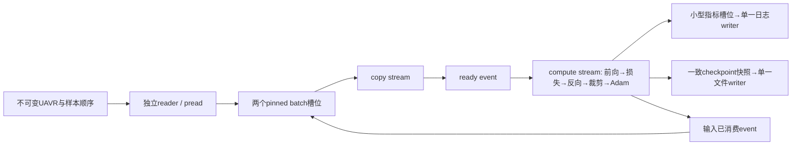

# uav_rgb 并行训练与正确性改造方案

- 日期：2026-10-29
- 状态：实施方案；下述新接口、命令选项和验收目标尚未实现
- 主线：设备常驻执行器 + 梯度并行归约 + 有界数据流水线；数据可信性同步推进
- 基线：`../experiments/pipeline_profile/README.md`，实测原始证据在 DATA_ROOT
- 适用设备：当前 RTX2080Ti / sm_75 / CUDA12.8，FP32
- 详细实施版更新：2026-10-29；第1–9节为总体决策，第10–22节为任务拆分、接口和验收细则。
- 代码实现说明：**第23–31节是算子实现，第32–38节是接口接线、调度和失败处理的补充规格**。
  本次重点补齐异步接口、训练主循环、恢复位置、评测聚合和可执行验收条件，并修正原地别名、
  大logits的CE运算顺序及checkpoint提交失败的描述。所有示例仍是待实现规格。

阅读顺序：集成负责人先读第10/11/18/21节；执行器开发读第12–14节；kernel开发读第15节；
数据与运行模块开发读第16/17/19节；审查者按第20/22节逐项验收。所有新路径与选项均为设计草案。

## 1. 目标与范围

首先让现有100388参数、RGB四动作CNN正确且高效地训练，不同时换模型或学习目标。
保留自研C++/CUDA约束，不引入PyTorch/cuBLAS/cuDNN/TensorRT/ROS2。
保留现有CPU参考及host-in/host-out CUDA路径用于对照，通过新增执行器渐进迁移。
现有四动作、学生RGB-only、UAVR布局、评测指标含义继续遵守既有合同。

成功的衡量是相同工作负载下吞吐、步时延、数值正确性和数据有效性；不要求GPU利用率必须100%。
暂不扩展语言/GRU、混合精度、多GPU、通用自动微分、NPU部署或大规模UI重构。

本轮源码已存在无权train_ce、宏指标、混淆矩阵和最终test评测；这些作为现有能力接入，
不要按旧报告重复实现。正式调参只看train/val，最终test在方案冻结后使用，不用test选性能/模型超参。

## 2. 已测瓶颈与工作排序

batch32、120×160的8步捕获：单步约506ms；kernel约102ms；每步malloc/free各121次、
memcpy146次、device-sync47次，H2D+D2H约766MB。dW/db占kernel时间约90.8%。
第一层dW仅2blocks、db每层仅1block。当前热缓存读取约3ms，不是第一瓶颈。
这些数字来自短程共享机器实验，P0须重建固定版本重复基线，不能用一次短测承诺加速倍数。

两条可以并行推进的线：

- 训练线：冻结接口/基线 → 设备常驻整步 → 归约优化 → 预取与融合。
- 数据线：几何分组隔离 → 传感器有效性 → 固定sim-time动作窗口 → 小规模正式数据。

训练线可先用固定合成集和已有小样本验证，不等待正式采集；正式研究成绩须等数据线通过。

## 3. 目标执行结构



权重、Adam m/v、激活、梯度和中间归约空间留在GPU。每步传入输入/标签、传出小指标；
只有初始化、检查点保存或明确导出才搬完整模型状态。先完成单compute stream版本，再加copy stream。
同一stream内依赖由提交顺序保证；跨stream使用event，禁止靠隐式默认流行为碰运气。
同一模型相邻step有Adam更新依赖，不并行更新同一参数。

## 4. 接口与所有权先冻结

以下为拟新增职责，不是当前可调用API。初期只支持项目需要的连续NCHW FP32。

| 对象 | 职责 | 必须遵守的生命周期 |
| --- | --- | --- |
| DeviceBuffer | 唯一拥有一段显存，可移动、不可复制 | 初始化分配；工作完成后释放，不在算子内反复分配 |
| DeviceTensorView | 非拥有指针、shape和元素数；连续reshape只改元数据 | 不得超出buffer生命周期，不能隐式拷贝到host |
| ExecutionContext | 持有device、compute stream、event与错误状态 | 每个训练执行器独占；析构前完成受控收尾 |
| CnnWorkspace | 最大batch对应激活、梯度、argmax、partial sums | 尾batch使用有效范围；重配须排空在途任务 |
| DeviceTrainState | 平铺参数、梯度、Adam状态和step，保留参数偏移表 | 只由compute stream更新；与既有8参数顺序可互转 |
| BatchSlot | host pinned与device输入buffer、序号、ready/consumed event | CPU/H2D/计算各自完成后才能复用对应存储 |
| RunOwner | 输出目录锁与唯一run标识 | 任一时刻一个训练writer；冲突启动立即失败 |
| CheckpointSnapshot | 某个已完成step的不可变状态 | 单独拥有快照，写盘期间不引用仍在更新的参数 |

device算子接收只读/可写view、形状参数、预分配scratch和显式stream，异步提交且无隐式H2D/D2H。
launch立即检查cudaGetLastError，执行错误在event/stream同步边界检查并写fatal事件。
调试模式可逐算子同步；生产模式只在读指标/存快照/换workspace等明确边界等待。
第一版仍按当前每步日志合同写指标，可保留一次小结果等待，不能借优化静默降低日志频率。

建议目录：`src/include/uavrgb/device/`、`src/device/`、`src/tests/`。
文件按buffer/context、conv、nn、loss、model、optimizer和workspace职责拆分；
遵守C++≤280行、CUDA≤360行，不用压缩注释规避限制。

## 5. 实施阶段与退出条件

| 阶段 | 交付 | 必须通过才进入下一阶段 |
| --- | --- | --- |
| P0：版本与合同 | 当前源码hash/版本基线、固定样本序列、接口头与资源规则、run目录锁、CLI有限值/shape检查 | 基线在同版本可复跑；同out双启动被拒绝；NaN/Inf/越界配置不进入更新 |
| P1：设备常驻 | 新执行器跑通完整forward/backward/clip/Adam，host参考路径可选 | 逐层输出/梯度、一次更新及短训练对拍；稳态0次device malloc/free，无中间激活及Adam往返 |
| P2：并行归约 | dW/db分块归约、必要的FC/norm优化，输出确定的归约顺序 | CPU参考+数值梯度+新旧对拍；小/大/尾batch/边界通过；整步重复性能优于P1 |
| P3：流水线 | 独立reader、有界双pinned槽、copy/event重叠、停机与异常回收 | batch顺序不变，无覆盖/重复/遗漏；Nsight能验证重叠；吞吐不劣于P2 |
| P4：正式小批验收 | 可信场景隔离数据、完整trainer对照、checkpoint恢复、统一入口 | 数据门禁通过；独立val与类别指标正常；实际训练吞吐和恢复语义可复现 |

拟新增CLI `--backend reference|resident`，迁移初期默认reference；该选项当前不存在。
resident显式失败时报告错误，不静默回退或在epoch中途换引擎。全部门禁通过后再切换默认。
旧checkpoint先通过host临时状态校验再上传；新格式升级后显式区分兼容加载与可精确恢复。

### P1：先消除搬运，不同时改全部数学实现

- 先给现有kernel增加device调用层，尽量保持算术顺序；旧host包装继续服务参考测试。
- 模型初始化一次上传；所有算子输出由workspace提供；FC flatten使用连续view。
- 第一版输入用pinned FP32，batch32输入约7.37MB；归一化规则继续为uint8/255。
- 可在P3单独比较uint8上传后GPU归一化，输入降到约1.84MB；这不是P1强制要求。
- 梯度裁剪在全部梯度就绪后求一次全局范数；全部参数完成更新后增加全局step。
- 先允许epoch末同步快照，验证一致性后才加后台写盘，不以异步为由允许半更新checkpoint。

### P2：明确扩大并行工作，不只增加stream

- dW沿N×H×W拆固定片段：第一阶段计算多个partial sums，第二阶段归并每个权重。
  tile大小按sm_75与实际维度测量选择，scratch有预算上限，不能随batch无界膨胀。
- db同样分块归约，避免每通道单线程扫整张图；优先处理，因为本次占kernel时间28.3%。
- norm先warp/block归约再求全局和，减少每个参数对同一double地址的atomicAdd。
- FC点积按归约维协作；以当前shape为优先，不建设通用高性能矩阵库。
- FP32求和顺序变化须公开误差；不承诺与旧路径逐bit相同。
- 可先独立验证db，再迁移dW；每一项有独立正确性和整步性能结果，避免把所有优化一次合入。

### P3：有界流水线与停止协议

- 选Linux pread或每worker独立句柄，不给共享ifstream加无序线程调用；初期1个预取worker。
- slot状态明确：FREE→FILLING→READY→COPYING→COMPUTING→FREE。
  pinned存储在copy完成后可复用，device输入在计算完成后可复用，不能混淆两个生命周期。
- 输出batch遵守预定顺序；worker完成早晚不得改变shuffle或逻辑batch组成。
- 队列深度先2，按实测扩展；队列满有背压，异常唤醒等待者；Ctrl-C不阻塞join、不丢fatal事件。
- 融合CE/gradient/accuracy及批量Adam在此后按profile逐项加入；CUDA Graph等稳定shape后再评估。

## 6. 数据与正确性整改

| 问题 | 实施决策 | 验收 |
| --- | --- | --- |
| 不同ID同几何跨split | 规范化障碍形状/尺寸/位置/姿态及任务配置生成几何组ID；整组固定split | train/val/test几何组交集为0；seed4/1618回归不再跨组；改变注释不改变组ID |
| 同车道模板过于相似 | 精确几何去重之外划分场景族，后续增加布局族 | 报告场景族留出；不能把hash不同当作泛化充分 |
| 传感器停更被当有效 | collision/clear/unknown分开；depth/pose/RGB新鲜度和因果配对显式校验 | dead订阅、旧帧、缺帧、时钟重置故障注入必须拒收或记录降级 |
| 并发改变动作位移 | 用sim-time确定动作结束；墙钟只用于超时看门狗 | 改变负载时动作模拟时长仍满足冻结容差，输出sim_dt/RTF与失败率 |
| 实验输出竞争 | run锁，单日志writer，唯一临时checkpoint；不静默追加到非resume run | 双进程同out失败；异常退出释放所有权；原成果不被覆盖 |
| 恢复非等价 | 保存sampler/RNG、epoch/batch位置、优化器配置、数据指纹、归一化规则 | 同backend连续训练与中断恢复下一批及状态匹配；旧格式明确非精确恢复 |
| 加载部分污染状态 | 临时对象完整读取、校验shape/长度/有限性后swap/上传 | 截断、坏数值、格式错误后原模型/Adam不变 |

传感器容差先依据30Hz发布周期和实测时间偏差写成配置与版本化合同，再冻结运行故障实验；
不凭空指定“任何平台100ms都安全”。clear须有健康传感器的对应时间窗证据，缓冲没看到消息不能充当clear。
现有数据不原地重标；新质量规范生成新数据版本，并保留原manifest可追溯。
已有UI与collect.py可能由其他会话维护；实施前核对当前负责者并建立文件分工，先准备独立补丁/契约，
不能为并行开发让两个会话同时编辑同一文件。底层全局约束由集成负责人统一落地。

加权目标固定为一个逻辑batch的加权CE，分母为该逻辑batch全部样本权重和。
microbatch仅为执行切分，使用相同全局分母累积梯度；不能把各microbatch平均loss简单相加。
batch=1时正权重约掉是该目标的数学性质；如需改变采样/目标，另开实验，不混入性能A/B。

## 7. 正确性与性能验收协议

正确性先于性能，测试在P0冻结用例、数据范围、容差与失败行为：

- 单算子：CPU参考、FP64有限差分、小规模随机对拍；覆盖tail、padding、池化并列最大值、
  极端logits和非法shape。梯度检查避开ReLU/MaxPool不可微点，并验证选定次梯度约定。
- 归约：同时报告max abs、relative L2及误差随归约长度变化；近零值不能仅按相对误差判断。
  按算法长度和FP32数值分析制定逐算子容差，禁止看到优化结果后随意放宽到通过。
- 整网：固定输入、标签、权重、batch顺序，比较logits/loss/dW/db/裁剪系数/Adam m-v及更新参数。
- 整步后检查参数/梯度有限性；数值溢出必须阻止更新或终止，不能只把日志NaN写成null继续跑。
- 短训练轨迹、合成过拟合、类别不平衡验证；相同backend中断恢复；新旧backend不要求逐bit相等。
- 并发：loader顺序、slot复用、失败退出、输出锁、checkpoint快照与磁盘失败路径。
- CUDA越界和同步错误使用compute-sanitizer覆盖小用例；工具不可用时明确NOT_RUN，不记PASS。

性能测量：

1. 固定源码/二进制hash、设备、数据、batch序列、seed、优化器、加权配置和验证/存盘频率。
2. batch1/8/32/128、同一固定数据，各至少5步热身、20步测量、3次独立重复；A/B交替运行。
3. 主指标是不带profiler的整步samples/s中位数及p50/p95；完整trainer另测包含验证与checkpoint的吞吐。
4. Nsight单独解释拷贝、分配、同步、stream重叠和kernel网格；不把profile运行与普通运行直接算加速比。
5. 同一GPU性能实验排队；记录其他进程与显存占用，有竞争则标为受干扰并安排隔离复测。
6. 新异步路径阶段GPU耗时用CUDA event；host墙钟测完成的整步，不能只测enqueue速度。
7. 冷盘/热缓存与真实数据各留一组，避免只在合成小数据上优化。

| 指标 | 当前短测 | 拟定验收目标 |
| --- | --- | --- |
| 稳态step device malloc/free | 各121 | 各0（初始化/重配/保存不计入） |
| 中间激活/参数/Adam每步往返 | 有 | 无 |
| batch32单步H2D+D2H | 约766MB | FP32输入阶段约输入7.37MB+标签+小指标；不含checkpoint |
| 热路径cudaDeviceSynchronize | 47 | 0；使用必要的event/stream边界等待 |
| 正确性/故障/恢复门禁 | 局部测试 | 全部指定门禁通过 |
| 完整训练吞吐 | 需P0重测 | 首轮工程目标≥同条件参考路径2倍；是待实测目标，不是承诺 |

达到架构目标但未达到2倍时保留profile并定位剩余瓶颈；不靠改变batch、跳验证、降低精度或少写日志凑倍数。
未通过正确性门禁的版本无论快多少都不切默认。数据线门禁未过时只能报告训练性能，不报告导航泛化。

## 8. 并行开发组织

按当前4个agent槽位组织：1个集成负责人+3个实现任务；这是实施时的分工，不在本次方案交付中启动改写。

| 角色 | 独占文件/职责 | 可独立验证 |
| --- | --- | --- |
| 集成负责人 | 接口合同、CMake注册、trainer/CLI桥接、版本/benchmark/集成验收 | 新旧路径对照、性能与数据门禁 |
| A：设备执行器 | src/device内buffer/context/workspace/model/state模块 | 生命周期、显存布局、旧kernel的设备调用 |
| B：数值kernel | src/device内conv/reduce/nn/loss kernel模块 | CPU/FP64/随机对拍、独立kernel微基准 |
| C：数据与运行正确性 | 独立reader/prefetch/run锁/快照模块；之后切换仿真数据门禁 | CPU故障测试、顺序/隔离/格式兼容 |

依赖规则：负责人先冻结小接口；A/B可在固定device view和scratch合同上并行；
C不依赖GPU执行器，先完成CPU与数据隔离工作。P1正确后集成B优化，P2稳定后接C预取。
GPU性能实验单独排队；CPU单测、源码审查和编译可以并行。并行开发数量不等于并行跑GPU负载数量。

工程操作建议：先给当前用户成果建立可追溯基线，忽略venv/build/数据/权重，再用独立分支/worktree；
当前无Git时先做文件hash与只读基线快照，禁止覆盖共同文件。每项小改动附测试和worklog后交集成负责人。
共享头/CMake/trainer只由负责人编辑；若需要接口变化，先提出契约变更再推进依赖实现。

## 9. 第一轮具体交付与停止条件

第一轮交付只包含：固定基线与接口、设备常驻完整一步、独立数值对照、checkpoint桥接、
可选择的新backend和性能报告。归约kernel优化可并行准备，但必须分别量化P1/P2收益。
这样能够清楚判断“去搬运”和“扩大kernel并行度”分别改善多少。

发现任意NaN/越界/数据错序/检查点不一致，立即停止该候选性能验收并保留失败用例。
显存不足在训练前报告workspace预算；不静默缩batch。CUDA执行错误产生fatal事件并退出，
不吞异常、不把未知碰撞当无碰撞、不通过修改数据划分改善表面指标。

本方案完成后，后续主线才是可信小批数据训练→学生SimulatorEval闭环→端侧合同。
设备优化与模型有效性分开验收，分别保留证据。

## 10. 版本固定与第一批任务

实施第一步先核对当前文件，不能直接沿用2026-10-29早先的行号或13项测试数量。
本项目有其他会话编辑过trainer、eval_metrics；工作开始时生成源码清单、SHA256、构建配置及
`ctest -N`结果。记录CUDA/GCC/CMake版本、GPU型号/显存、数据hash、编译选项和git状态。

基线目录只放源码快照和清单，排除build、venv、模型和数据。若建立Git，先确定忽略规则，
不把当前改后快照描述为“原始未修改版本”；已有成果全部纳入当前起点。每个任务使用独立工作树
和构建目录。没有Git时由负责人管理模块所有权，交付带文件hash的补丁，不覆盖另一个任务的新文件。

第一批任务编号固定如下，方便在工作记录和提交中引用：

| ID | 负责人 | 输入 | 输出 | 依赖 |
| --- | --- | --- | --- | --- |
| T00 | 集成 | 当前源码/实测报告 | baseline清单、固定batch序列、benchmark协议 | 无 |
| T01 | 集成+A+B | 现有算子合同 | device view/context/算子原型、参数布局表 | T00 |
| T02 | A | T01接口 | buffer/context/workspace及生命周期测试 | T01 |
| T03 | B | T01接口、现有kernel | 保持数学顺序的device launch层 | T01 |
| T04 | C | 数据/输出目录合同 | pread reader、run锁、失败路径测试 | T00 |
| T05 | A | T02/T03 | resident前向、反向、Adam完整一步 | T02/T03 |
| T06 | 集成+C | T05、现有checkpoint | CLI桥接、旧格式兼容与状态导入导出 | T05 |
| T07 | B | T03、数值基线 | db→dW→norm优化，逐项独立报告 | T03 |
| T08 | C+A | T04/T05事件合同 | 有界预取与双输入buffer | T04/T05 |
| T09 | C/集成 | 仿真采集接口 | 几何分组、新鲜度和sim-time门禁 | 可从T00并行 |
| T10 | 集成 | 所有候选模块 | 对拍、完整训练A/B、正式切换建议 | T06/T07/T08 |

每项交付必须包含：变更文件、接口变化、实际命令/退出码、失败样例、未覆盖项、候选二进制hash。
T05完成前不把T07优化版作为唯一实现；必须能单独比较“旧路径”“resident旧算法”“resident新算法”。

## 11. 文件与构建边界

拟新增文件按职责分组，最终可为遵守行数限制拆分，不能把全部执行逻辑写进一个trainer文件。

| 路径组（拟新增） | 内容 | 主要所有者 |
| --- | --- | --- |
| `src/include/uavrgb/device/view.hpp` | 连续view、只读区分、shape/容量检查 | 集成 |
| `src/include/uavrgb/device/context.hpp` | stream/event、状态与错误合同 | 集成 |
| `src/include/uavrgb/device/ops.hpp` | device算子声明、别名及scratch约束 | 集成 |
| `src/device/buffer.*`、`context.*` | RAII显存/锁页内存/事件实现 | A |
| `src/device/workspace.*`、`parameter_layout.*` | 容量规划、参数偏移、张量视图 | A |
| `src/device/conv_forward.cu`、`conv_backward.cu` | 卷积launch与kernel | B |
| `src/device/nn.cu`、`loss.cu`、`reduce.cu`、`adam.cu` | 其余device算子 | B |
| `src/device/model_forward.*`、`model_backward.*`、`executor.*` | 固定CNN图、整步状态机 | A |
| `src/data_reader.*`、`batch_prefetch.*` | 按偏移读取、槽位和异常传递 | C |
| `src/run_owner.*`、`checkpoint_snapshot.*` | 输出锁、一致快照 | C |
| `src/tests/test_device_*`、`test_prefetch*`、`test_run_owner*` | 对应边界和故障回归 | 各模块所有者 |
| `src/CMakeLists.txt`、`train_main.cpp`、`trainer.cpp` | 依赖接入、CLI与日志桥接 | 集成 |

建议新建`uavrgb_device`目标，复用小型公共类型；host参考目标不依赖resident执行器。
trainer可同时链接两条路径，device代码不能反向调用trainer造成循环依赖。
先为新device算子实现独立测试；旧host包装是否复用新launch层，在P1完整对拍后另做小提交，
避免测试参考实现和被测实现同时大改、相同错误相互印证。

CPU文件使用既有警告选项；CUDA继续只编sm_75。性能版不随意加入`--use_fast_math`，
它会改变数值合同。Release/Debug/sanitizer配置各用独立build目录，避免混用优化选项。

## 12. Device接口草案与失败行为

下例用于固定职责，仍需T01落实可编译头文件，不能照例声称接口已存在。

```cpp
namespace uavrgb::device {
template<class T> struct View {
  T* data;                         // T=const float 表示只读
  std::int64_t dims[4];            // 连续布局，rank以内有效
  std::uint32_t rank;
  std::uint64_t numel;
};
struct Context;                   // device + 显式non-blocking stream
struct ConvSpec;                  // N/CI/CO/H/W/KH/KW/pad，已校验
struct Scratch;                   // 调用者预分配，带容量

void conv_forward(Context&, const ConvSpec&,
                  View<const float> x, View<const float> w,
                  View<const float> b, View<float> y);
void conv_backward(Context&, const ConvSpec&,
                   View<const float> x, View<const float> w,
                   View<const float> dy, View<float> dx,
                   View<float> dw, View<float> db, Scratch&);
}
```

所有算子遵循相同规则：

1. host入口检查rank、shape、元素数乘法溢出、容量及不支持的别名；失败时不提交kernel。
2. 第一期只允许连续布局；slice必须是连续区间，reshape必须元素数相同，不接受任意stride。
3. buffer的device必须与context相同；允许host保存设备指针，不允许CPU解引用它。
4. 输出区间必须被kernel全部写满，或在该stream上显式清零；不能依赖上一步残留数据。
5. 默认输入/输出不得重叠；允许原地ReLU等优化需单独列白名单，不能推导所有算子都可原地。
6. scratch查询函数只计算所需容量，不分配显存；容量不足返回可诊断错误，不临时cudaMalloc。
7. view不延长生命周期；executor保证buffer在最后使用它的event完成前不销毁、不移动所有者。
8. context提供显式`finish()`检查异步错误；析构不抛异常，不能仅靠析构发现错误后静默吞掉。

tail batch使用`actual_batch<=max_batch`，kernel只读写有效范围。测试必须用较大batch之后接较小batch，
确认没有把旧尾部样本加入loss/梯度。容量变更仅在executor闲置、copy与compute任务均完成时发生。

设备错误后将executor标为FAILED，停止接收新batch，唤醒队列并记录失败step。
不得在CUDA上下文状态未知时继续训练或导出“最新有效checkpoint”。恢复使用上一个已完整提交的文件。

## 13. 显存布局、预算与生命周期

当前网络以NCHW的H=120/W=160为例，不能把尺寸写反。

| 张量 | 每样本shape | float元素数 |
| --- | --- | ---: |
| 输入 | 3×120×160 | 57600 |
| conv1 / relu1 | 16×120×160 | 各307200 |
| pool1 / argmax1 | 16×60×80 | 各76800 |
| conv2 / relu2 | 32×60×80 | 各153600 |
| pool2 / argmax2 | 32×30×40 | 各38400 |
| conv3 / relu3 | 64×30×40 | 各76800 |
| pool3 / argmax3 | 64×15×20 | 各19200 |
| flatten | 19200 | 与pool3共享view，不另分配 |
| logits / dlogits | 4 | 各4 |

P1优先保留各层forward缓存，便于逐层对拍。按float32和每个argmax4字节计算，
输入加forward缓存为每样本1401600个4字节元素。反向可规划两个最大激活大小的临时区，
按操作顺序交换读写，不覆盖仍被当前算子或后续梯度计算需要的forward缓存。
如果实施证明某步需要第三块临时区，必须更新预算，不能为了满足表格而制造别名错误。

| batch | 输入+forward缓存MiB | 两个反向临时区MiB | 第二输入槽MiB |
| ---: | ---: | ---: | ---: |
| 1 | 5.347 | 2.344 | 0.220 |
| 8 | 42.773 | 18.750 | 1.758 |
| 32 | 171.094 | 75.000 | 7.031 |
| 128 | 684.375 | 300.000 | 28.125 |

100388个参数的parameter/gradient/m/v四块FP32区约1.532MiB。
额外计入logits、标签、指标、归约scratch、对齐、可选快照；建议归约scratch初始上限64MiB，
由实际scratch查询验证可行性。上述为规划公式，不是cudaMemGetInfo实测峰值，不能当完整显存上限。
两个host pinned FP32输入槽batch32合计约14.063MiB，另加标签和小指标；锁页内存也要有限额。

参数偏移表保持现有顺序：c1.W/c1.b/c2.W/c2.b/c3.W/c3.b/fc.W/fc.b。
平铺区每段记录shape、offset、count，所有布局先在host验证无重叠、总长度100388。
不能改变矩阵行列含义来“适配”kernel而不同时验证checkpoint和梯度映射。

P1保留现有float argmax语义，检查索引可精确表达；P2可改为uint32索引并用适配测试比较，
所有并列最大值仍按既有行优先第一个选择。优化后不需要保存的relu/conv副本可再移除，
但必须以显式张量生存期分析为依据，一次只改变一种内存复用策略。

## 14. 完整训练步与事务边界

拟定单步顺序如下，初期只允许一个未完成的参数更新；可以有下一批输入传输在途。

```text
检查BatchDescriptor与输入槽所有权
compute stream 等待 batch.ready
forward: Conv1→ReLU1→Pool1→Conv2→ReLU2→Pool2→Conv3→ReLU3→Pool3→FC
loss: 数值稳定softmax、无权CE/加权目标、accuracy、dlogits
backward: FC→Pool3→ReLU3→Conv3→Pool2→ReLU2→Conv2→Pool1→ReLU1→Conv1
finite检查与global grad norm
若loss/梯度非法：跳过整个Adam提交，标记FAILED，输出fatal事件
按同一裁剪系数缩放全部参数梯度
Adam使用候选t=已完成step+1更新8个参数段与m/v
检查更新结果有限性；非法则终止且不保存本步checkpoint，成功才提交step编号
复制小指标到host，记录 step.done / input.consumed
host完成事件检查、记录metrics，并释放输入槽
```

梯度非法时“跳过Adam”必须在device执行路径上真正生效，可用device有效性标志让所有更新kernel
统一不执行；不能等host读到NaN时参数已经更新。更新后才发生的溢出不要求自动回滚整步，
第一版定义为失败终止、保留前一份有效checkpoint。只有全步成功才计入成功样本数。

P1逐张量Adam保持现有公式：epsilon加在sqrt(v_hat)之后、t从1开始、各段同一t。
P2平铺单次Adam需验证偏差校正精度、eps位置和所有段索引，不能为减少launch改变数学公式。
裁剪系数沿用`min(1, max_norm/(norm+1e-6))`；零范数、非法阈值有显式行为。

建议返回小型StepMetrics：step/batch_size/weighted_objective/plain_ce/correct_count/
grad_norm/clip_coef/finite_flags。通过现有事件适配器输出，原有字段语义与schema保持兼容；
计时等新增字段先作为可忽略扩展，不随意改名。无权train_ce和带权优化目标分别记录。

## 15. CUDA算法实施细则

### 15.1 先优化db

令R=N×OH×OW。网格按输出通道oc与归约分片s展开，每个block处理一个(oc,s)，
block内线程以步长blockDim.x读取该片段的dy，warp/block归约到一个partial。
第二个kernel对每个oc的partial数组固定顺序归约，得到db。

初始候选block大小128/256；分片长度1024/4096/16384仅作待测候选，T00阶段固定候选集合，
不在最终test集上调优。小R可直接单block/channel避免两阶段开销，选择阈值记录到profile。
partial布局为`[out_channels, num_splits]`，所有有效元素必须覆盖，最后一片进行边界判断。

### 15.2 dW两级归约

权重索引w映射为(oc,ic,ki,kj)。归约索引r映射为(n,oh,ow)，计算：

```text
ih = oh - pad + ki; iw = ow - pad + kj
term(r,w) = dy[n,oc,oh,ow] * x[n,ic,ih,iw]   若输入坐标有效
term(r,w) = 0                              否则
dW[w] = sum_r term(r,w)
```

第一版每个block负责(w,s)，线程协作扫描R的一个片段，block归约后写partial[w,s]。
这使网格由“每256个权重一个block”变为“每个权重多个归约block”，明确扩大并行度。
scratch需求为`num_weights × num_splits × sizeof(accumulator)`，用检查乘法防溢出。
若超过预算，减少split数、增加每片长度；或者按权重tile分批处理。此行为是确定的调度选择，
写入配置/性能记录，不能训练途中偷偷改变逻辑batch。

先使用FP32 partial和固定树形归约，对照FP64参考评估误差；需要时单独比较更高精度累加，
不能假设Turing的FP64代价与FP32相同。第一版尽量避免跨block对最终dW做atomicAdd，
有利于固定求和顺序；确定性范围仍限定同设备/工具链/算法配置，不承诺跨平台bitwise。

两级归约可能增加读取和launch开销，因此必须分别测c1/c2/c3及整步。若某层R很小，
保留简单kernel可能更快，允许静态shape dispatch，但所有分支使用同一数值合同和测试。
优化后conv forward或dx可能变成新瓶颈，届时根据新profile决定tiling，不预设无限优化范围。

### 15.3 其他算子

- norm：每block累加多个梯度元素，再归约partial；平铺参数后一次处理全部梯度。
  累加精度遵守现有double范数合同，避免100388次对单地址double atomic。
- FC：每(n,class)由warp或block协同19200维点积，测试相邻线程访存连续性；4类输出无需通用GEMM。
- loss：每样本使用减max的softmax，生成dlogits；另汇总CE、正确数与带权分母。
  不能逐microbatch各自归一化再求均值。标签越界或总权重为0默认报错，不静默产零梯度。
- MaxPool backward：当前k=s=2窗口不重叠，可专门实现无冲突写入版本；一般重叠窗口仍须正确累加。
  每步先清零或用覆盖式gather，不能遗漏未命中argmax的输入元素。
- 融合：Conv/ReLU或ReLU/Pool等只在独立版本通过后增加；测试并列值、零值、负值和梯度掩码。

## 16. Reader、batch顺序与跨stream协议

BatchDescriptor建议含epoch、batch_index、global_step、sample_indices、actual_count和logical_batch_id。
sampler由训练控制线程唯一持有，先生成顺序再分发；worker不能自己shuffle。
pread实现必须处理EINTR、短读、EOF和偏移越界，读满才发布READY。数据文件在run期间视为不可变，
启动记录指纹；检测到被替换/截断则中止，不能让一个run混用两个数据版本。

槽位第一版采用保守整体复用：一个slot包含host pinned和device输入，直到计算完成再标FREE。
随后如需在H2D完成后提前复用host区，应将host/device两套状态机分开；不能只改一个FREE标记。
每槽位附generation编号，防止旧任务的完成通知释放已经被新任务占用的槽位。

```text
loader: 等FREE(slot,g) → FILLING → 读取/转换 → READY(slot,g,batch_id)
submit: copy stream发H2D → record ready_event(slot,g)
compute: wait ready_event → 完整训练步 → record consumed_event(slot,g)
host: 确认 consumed_event完成且generation一致 → FREE(slot,g+1)
```

batch k计算期间可加载并传输k+1，k+1参数更新仍需等k更新完成；pinned buffer不能在H2D完成前改写。
显式non-blocking stream避免默认stream隐式排序；所有共享scratch只给compute stream使用，
copy stream只接触输入槽。后续要并行多个计算kernel时必须重新审核scratch冲突。

第一版只创建1个reader worker，队列深度2；后续比较1/2/4 workers，但不能让worker数量
改变样本顺序。数据预取结果在恢复时可丢弃重建，检查点记录的是下一批应消费的位置，
不能记录worker已经预读到的位置。

停止时控制线程设stop并notify所有条件变量；loader捕获异常存入exception_ptr并唤醒消费者。
CUDA在途任务受控finish后回收，若上下文报错按FAILED清理；不无限等一个永远不会READY的槽位。
worker无权写训练metrics或checkpoint，避免交错输出；必须通过统一事件/错误通道上报。

## 17. Run所有权、检查点格式和恢复

### 17.1 输出目录单writer

启动先规范化out路径、创建/打开锁文件并获取Linux非阻塞排他flock，再读取旧状态或写配置。
锁持有到所有日志/快照writer退出；用O_CLOEXEC避免子进程意外继承锁，不能仅以“锁文件存在”判锁。
已有非空run目录且未指定resume时拒绝写入；resume须核对run配置和checkpoint来源。
本地文件系统是首个支持范围；网络文件系统锁语义未测时明确不支持，不声称跨机器排他。

run manifest记录run_id、父run/恢复来源、源码与二进制hash、环境、数据/场景组指纹、backend、
逻辑batch、microbatch、seed、sampler版本、optimizer参数、dtype和记录频率。
配置落盘必须是生效值，不能只是原始命令行字符串。

### 17.2 checkpoint v3草案

保持v2只读兼容；拟新增v3自描述头与分区表，字段逐个小端序列化，禁止直接写C++ struct内存。
具体字节偏移在T06通过读写用例冻结，不在两个agent各自手写不同格式。

| 内容 | 必需字段 |
| --- | --- |
| 头 | magic/version/header_bytes/total_bytes/section_count、完整性校验信息 |
| 模型 | shape、参数段名称/顺序/count、dtype、模型合同版本 |
| 状态 | 参数、Adam m/v、uint64 step、epoch、下一批位置 |
| 优化器 | lr/beta1/beta2/eps/max_grad_norm、类别权重、归一化规则 |
| 采样 | 算法版本、当前排列或可精确重建的信息、RNG状态及运行库约束 |
| 数据 | dataset hash、scene split manifest hash、训练样本过滤规则 |
| 执行 | backend/kernel算法版本、逻辑batch、是否支持精确恢复 |

优先保存当前epoch的排列与下一批游标，避免仅存seed却依赖不同标准库的shuffle行为。
检查点位于完整optimizer step边界；第一版不支持microbatch累计一半时恢复。
新格式的字段长度、section offset/重叠、乘法溢出、dtype、参数与Adam有限性均先校验。
完整性校验覆盖规范化字节，算法和依赖在T06明确；未实现校验之前不得宣称支持损坏检测。

### 17.3 保存和加载的事务

保存：optimizer完成 → compute stream上复制到独立host快照 → 等D2H完成 → writer写唯一临时文件
→ 检查write/flush/fsync结果 → 同目录rename → fsync目录 → 发布checkpoint_saved事件。
第一次同步快照允许短暂停顿，后台writer仅减少磁盘等待，不能一边更新参数一边从活跃状态分批读。
快照队列上限1；默认背压而不丢弃请求，耗时计入完整训练吞吐。
rename之前失败不覆盖旧checkpoint；rename成功但目录fsync失败时，新目标可能已可见，
必须报告持久性未确认，不能声称旧目标未变或发布保存成功。详见第36节。

加载：读入临时host对象 → 全量验证 → 构造候选device state并上传 → finish确认成功
→ 切换为有效状态。失败时已有有效模型和Adam保持原样。OOM或CUDA错误终止候选加载，
不能先覆盖半个旧模型再尝试继续。

v2已有参数、Adam m/v/t、epoch和类别权重，但缺RNG、采样游标和optimizer超参数；
读取后标注compatibility resume而非exact resume。
v3精确恢复要求数据、逻辑batch、采样算法、优化器及执行条件匹配；改变这些配置创建派生run，
记录差异，不继续声称与不中断训练一致。
事件可采用(run_id,event_type,step,epoch)定位重复；恢复时显式标记恢复点，
不静默把checkpoint之后未确认的数据当已完成step，也不删除用户旧日志。

## 18. CLI、配置与兼容迁移

以下选项是拟新增设计，落地前须更新`--help`、配置记录和真实命令测试：

| 选项 | 初始默认 | 规则 |
| --- | --- | --- |
| `--backend reference|resident` | reference | 不支持时明确失败，禁止静默回退 |
| `--max-batch N` | 等于batch | 容量上限，不自动改变逻辑batch |
| `--prefetch 0|2` | 0，P3后可改2 | 0保留同步对照，2启用两个槽位 |
| `--loader-workers N` | 1 | 初期仅允许1，扩展后测试顺序一致性 |
| `--debug-sync` | false | 诊断用，不与生产模式混算性能 |
| `--resume-mode compatible|exact` | 按格式显式解析 | v2不接受exact；拒绝含糊恢复 |

`--batch`继续表示一次逻辑更新的样本上限。microbatch如后续引入使用独立选项和配置字段，
不能把当前batch改成“单worker batch”导致总batch扩大。尾batch和过滤后的空batch行为明确：
尾batch有效样本正常更新，空batch不增加Adam step且记录原因，整epoch无可训练样本报错。

既有UAVR v1像素布局保持不变；数据质量扩展以新manifest schema/版本登记。
既有metrics字段保持可解析，未知新增字段由UI忽略；不得把性能日志写成训练loss事件。
监控UI仍按既有读取接口接入，真实训练启动按钮的配置兼容另做最小适配，避免阻塞执行器主线。

reference与resident运行时使用不同out目录；A/B不能同时追加同一results.csv。
发布切换依次经历显式试用→小批真实数据→默认resident；任何阶段撤回默认只改配置并保留证据，
不要删旧backend、旧checkpoint或历史失败报告。

## 19. 仿真与数据质量线详细任务

### 19.1 几何组ID与划分清单

从生成器结构化参数提取几何，排序障碍列表、统一单位与数值表示，并含shape/尺寸/pose，
排除scene_id、seed、文件路径、注释等无物理意义字段。量化精度来自生成器实际输出精度并版本化，
不能人为粗量化把不同障碍当同一个，也不能使用浮点格式差异让同几何逃过分组。

先生成全量候选的几何组，再冻结组到split的映射，输出split_manifest；精确重复组只能落一个集合。
不能每次重新排序已有数据后使旧场景改变split。使用固定salt的hash分配或固定清单均可，
建议首版冻结显式清单，报告各split独立几何数、重复率、类分布和场景族覆盖。
hash分配不能保证小数据严格80/10/10，样本不足时明确不足，不通过随机拆帧补齐。

独立配置scene family用于车道模板留出，区分“几何完全相同”和“相似模板捷径”。
几何/pose/depth只用于teacher和质量审查；student只拿RGB及合法标签，manifest内特权字段不转成模型特征。

### 19.2 有效性状态机

每一步保存rgb/depth/pose/contact各自的sim timestamp、消息序号、订阅健康状态、
对应时间差、world clock epoch及拒收原因。建议原因码包括DEPTH_STALE、POSE_STALE、
CONTACT_UNKNOWN、RGB_MISSING、CLOCK_RESET、ACTION_TIMEOUT。

action_expert只能由与当前RGB合法配对的teacher观测产生；动作发布之前的图像才是当前监督输入。
clock倒退或world重置时清空旧缓存并建立新的episode/clock epoch，不把旧世界图像与新动作拼接。
已有bool collision字段不能独自表达unknown：在episode v2添加collision_state与validity，
preprocess明确拒收unknown，旧数据缺字段只能以旧质量等级加载，不能自动升级为已验证。

contact是否持续发空消息需实际探测。如果只在碰撞时发消息，不能简单用“最近消息距离现在”
判断正常；需要独立的传感器/插件存活及时间窗覆盖证据，不能把进程存活等同于传感器健康。

### 19.3 sim-time控制与并行采集验收

动作开始捕获clock t0，目标结束时间t0+hold_sim；订阅clock推进达到目标后停止动作。
墙钟超时用于发现仿真卡住，单独记timeout，不拿它当动作正常完成。
自由运行Gazebo仍有发布/调度延迟，应记录实际sim_dt和超调；如超调无法满足合同，
改用受控pause/step方案并单独验证传感器帧与动力学步进，不能仅靠sleep缩短掩盖误差。

先1实例完成已知场景，再2/4/6实例同seed、同目标模拟时长比较：有效样本率、
sim_dt误差分布、有效模拟秒/墙钟秒、碰撞/unknown率、RTF。实例数增大导致质量不达标时
保留较低并发配置；不要以吞吐高为由放宽新鲜度门禁。训练与采集同时运行也必须检查资源干扰。

## 20. 测试矩阵与基准报告格式

| 测试组 | 关键用例 | 失败时阻断 |
| --- | --- | --- |
| view/buffer | move后所有权、非法shape、numel溢出、容量不足、尾batch | P1 |
| conv | batch1/3/8、非方形H/W、pad0/1、边界位置、tail归约片段 | P1/P2 |
| nn | ReLU负/零/正、Pool并列最大值/重叠窗口、argmax范围 | P1/P2 |
| loss | 大幅logits、标签越界、零权重类、总权重0、带权逻辑batch | P1/P2 |
| optimizer | norm0、超阈值裁剪、8段一致t、多步Adam、NaN/Inf | P1 |
| 整网 | 固定输入逐层dump、梯度与更新对拍、短训练/过拟合 | P1/P2 |
| loader | pread短读/EINTR/EOF、worker异常、tail、相同样本序列 | P3 |
| streams | slot复用、generation、不同延迟、停机与copy失败 | P3 |
| checkpoint | 截断、字段长度错误、非有限状态、磁盘失败、连续/恢复对照 | P4 |
| 输出锁 | 同out双启动、进程崩溃后重启、未resume写旧目录 | P0/P4 |
| 数据质量 | seed4/1618、注释变更、死传感器、clock reset | 正式数据训练 |

测试必须比较真实生产kernel的结果，不能只在另一个FP64实现内部做自我gradcheck。
有限差分用小尺寸/选定参数的生产路径扰动或独立数学参考交叉验证，报告eps和避开不可微点的方法。
小例测试可用严格容差，大归约同时报告误差上界与相对L2；T00冻结测试表，
新实现超过阈值需要数值分析和审查，不能自动调阈值直到PASS。

完整训练A/B除无权均衡合成集，还要跑固定不平衡数据与真实场景样本；
固定logical batch时验证microbatch拆分前后总梯度一致，避免优化顺便改变目标。

每次benchmark输出JSON/CSV，至少包括：

```json
{
  "schema": "uavrgb.benchmark.v1",
  "source_sha256": "...",
  "binary_sha256": "...",
  "dataset_sha256": "...",
  "batch_order_sha256": "...",
  "backend": "resident",
  "dtype": "fp32",
  "logical_batch": 32,
  "actual_steps": 20,
  "warmup_steps": 5,
  "repetition": 1,
  "profiler_enabled": false,
  "samples_per_sec": null,
  "step_ms_p50": null,
  "step_ms_p95": null,
  "device_peak_bytes": null,
  "result": "NOT_RUN"
}
```

示例中的null是未测占位，真正PASS报告不允许必需性能字段缺失；跳过的检查记录原因。
至少保留逐步原始时长，汇总中位数与p95用明确算法，不把3个平均值的最大值当步p95。
报告实验起止、GPU竞争进程、温度/时钟/功耗可见信息；不为测试擅自改宿主机驱动或时钟策略。

三次重复以A1/B1/A2/B2/A3/B3交替，固定预热和样本顺序。含profiling的运行独立存放。
冷缓存实验不执行全机drop_caches影响其他任务；使用独立数据/受控方法并说明无法完全冷盘的限制。
完整trainer计入数据准备、日志、验证、checkpoint和退出收尾；kernel微基准单列，不能混报。

## 21. 可分派提交顺序与审查清单

建议拆成下列小批提交或可审查补丁，每项通过再合并，不用一个巨大重构吞掉所有变化：

1. 基线与对照工具：固定输入、批序列和现有行为，保留当前失败用例。
2. run所有权与非法配置拒绝：不依赖新GPU路径，可先落地。
3. device类型/context/workspace：测试生命周期与容量，暂不接trainer。
4. device算子旧算法：逐算子对拍，避免同时优化归约。
5. resident整步：forward/backward/clip/Adam、有限性控制、参数导入导出。
6. backend接入与checkpoint桥接：reference默认，新路径显式选择。
7. db优化：正确性、独立性能与整步收益。
8. dW优化：分别报告三层结果与scratch占用。
9. norm/FC/loss/Adam优化：按最新profile选择，一项一份收益报告。
10. reader与双缓冲：同步/异步模式样本序列一致，异常和停止回归。
11. 新检查点恢复语义与正式数据门禁：版本化兼容、独立验收。
12. 默认切换候选：固定版本完整训练A/B和工作记录，仍保留reference。

每项审查需回答：是否增加隐式同步/分配？谁拥有buffer？什么时候可以复用？
失败发生在参数更新前还是后？日志是否能定位batch/step？哪些测试来自真正生产路径？
性能提升是否来自同工作量？新增分支是否有失败测试？代码行数与依赖约束是否满足？

并行规则具体化：T01头文件由负责人统一提交，A/B只提接口变更建议；
A不编辑B的kernel，B不改trainer，C不改device layout。需要跨模块修改时拆成接口提交和实现提交。
每个agent交付后先由另一角色做只读审查，再由集成负责人跑GPU集成测试。
CPU-only工作不必等待GPU；对拍和profiling预约同一GPU窗口，禁止用多进程抢占后宣称性能不稳定。

暂不按自然日承诺完成时间：实际工期由第一轮T05对拍、P2数值误差和外部并发修改决定。
用上述可验收提交而非“写了多少行”衡量进度。T05前能交付设备完整一步，T07后才能交付归约加速，
T10完成后才能声称整套训练流水线达标。

## 22. 完成定义、交付目录和后续边界

最终交付应包含：

- 可以从干净构建目录生成的reference/resident训练器与一键检查入口。
- 设备内存/线程/事件合同、参数布局、checkpoint格式和版本兼容说明。
- 逐层/整步数值对照、故障测试、sanitizer检查结果及明确NOT_RUN项。
- 固定条件下的3次完整性能对照和Nsight证据；稳态无device分配、无层间往返证明。
- 正式小批数据的几何组交集检查、传感器有效性、sim-time执行质量和类别分布报告。
- 一次连续训练与中断恢复的可重放证据，以及旧checkpoint兼容模式限制。
- 每次改动的过程文档，列清未覆盖任务；所有大数据/权重/trace放DATA_ROOT。

建议产物目录：`$DATA_ROOT/uav_rgb/experiments/<run_id>/`，其中保存environment.json、
resolved_config.json、source_manifest.json、commands.json、metrics.jsonl、benchmark.json、
test_results/、profiles/和checkpoints/。这些是拟定实验组织，不改变现有工具已输出文件的含义。
目录权限/锁归属以当前服务器环境验证；可复现不等于公开发布，外部服务和硬件操作不在本方案内。

默认切换resident的硬门禁是正确性、错误处理、可恢复性和结构性开销目标全部通过；
吞吐2倍是工程目标，未达到则报告实际收益与剩余热点，不伪称完成性能目标。
正式训练数据门禁未过时允许继续做性能研发，不允许发布导航泛化结论。
完成这一方案仍不等于完成无人机导航系统；下一项独立任务是学生SimulatorEval与真实闭环指标，
随后才是硬件平台、协议和端到端延迟验证。

## 23. 先改哪一段代码：从host返回值改成device输出参数

现有 `model.cpp` 调用链是：

```cpp
Tensor c1 = conv2d_forward_cuda(m.c1, x);
Tensor r1 = relu_forward_cuda(c1);
MaxPoolResult p1 = maxpool2d_forward_cuda(pool, r1);
```

每个函数内部创建DeviceBuf、上传输入、同步、下载输出并释放设备内存。
要改的是这一层接口：**device算子接收设备指针，结果写入调用方已经分配的设备地址**。

```cpp
// 拟新增的device调用层。下面的dx/c1/r1/p1都是device pointer。
launch_conv_forward(spec1, dx, weights.c1w, weights.c1b, ws.c1, stream);
launch_relu(ws.c1, ws.r1, n * 16 * 120 * 160, stream);
launch_pool2(ws.r1, ws.p1, ws.argmax1, n, 16, 120, 160, stream);
```

这三个launch函数里面只做shape检查、`kernel<<<grid, block, 0, stream>>>`和launch错误检查。
**它们内部不能调用cudaMalloc、cudaFree、cudaMemcpy或cudaDeviceSynchronize。**
数据在同一stream按顺序依赖执行，Conv写ws.c1后ReLU自然读取正确结果，不需逐层等待host。

P1具体实施：

1. 把现有`conv_cuda.cu`的forward/dW/db/dx算法迁入新device文件，先保持循环顺序。
2. 新增上述launch入口，旧`conv2d_forward_cuda`继续保留作为host参考对照。
3. 给ReLU/Pool/Linear/loss/Adam做相同device入口；先不融合、不换精度。
4. 新`ResidentExecutor`负责初始化上传、调用整个图、下载小指标及快照。
5. `Trainer::run()`按backend选择reference步骤或resident步骤；保留数据顺序/日志/验证逻辑。

下面23–38节的代码属于**实现规格和代码骨架**，不是已编译的生产补丁。
示例中的`check_cuda`、`checked_mul`、shape验证和事件封装必须按说明实现并测试。

## 24. 显存具体怎么分配：参数表和workspace

### 24.1 参数平铺的精确偏移

当前120×160、四类CNN采用以下float元素偏移，字节偏移为元素偏移乘4：

| 参数 | shape | offset | count |
| --- | --- | ---: | ---: |
| c1.W | [16,3,3,3] | 0 | 432 |
| c1.b | [16] | 432 | 16 |
| c2.W | [32,16,3,3] | 448 | 4608 |
| c2.b | [32] | 5056 | 32 |
| c3.W | [64,32,3,3] | 5088 | 18432 |
| c3.b | [64] | 23520 | 64 |
| fc.W | [4,19200] | 23584 | 76800 |
| fc.b | [4] | 100384 | 4 |

总计P=100388。实际实现由模型shape计算表并检查，而非仅支持这组硬编码数字。
分配四块P个float的设备区：params、grads、adam_m、adam_v。每个view指向`base+offset`。
例如`c2_dw=grads+448`，`c2_m=adam_m+448`，保证参数/梯度/优化器状态使用同一布局。

初始化在host依照现有`cnn_params()`顺序打包权重和checkpoint中的m/v，再各上传一次。
新训练的m/v在设备清零；恢复训练上传已有值，不能统一清零。类别权重上传一次直到配置变化。

### 24.2 一次分配arena，后续只取指针

实现`LayoutBuilder::reserve<T>(count)`，先做`count*sizeof(T)`及偏移加法溢出检查，
再把起点向上对齐到256字节，返回offset。完成所有张量登记后一次cudaMalloc总字节数。
每块区间保存类型/count/offset用于测试，不直接通过未经校验的指针运算制造view。

```cpp
// 示意：reserve只计算偏移；最后才分配内存。
LayoutBuilder layout;
auto c1_offset = layout.reserve<float>(max_batch * 16ULL * h * w);
auto r1_offset = layout.reserve<float>(max_batch * 16ULL * h * w);
auto p1_offset = layout.reserve<float>(max_batch * 16ULL * (h/2) * (w/2));
// 依次登记其他层、argmax、logits、dlogits、grad_a、grad_b、scratch。
DeviceArena arena(layout.total_bytes());
ws.c1 = arena.at<float>(c1_offset);
ws.r1 = arena.at<float>(r1_offset);
ws.p1 = arena.at<float>(p1_offset);
```

第一版输入使用两块独立device输入槽；workspace仅一份，因为同一模型只执行一个计算step。
host也只分配两块pinned输入和标签槽，使用cudaMallocHost/cudaFreeHost管理。
这些分配发生在executor启动，未进入训练循环；尾batch仅修改actual_count和view尺寸。

forward每层有独立输出区；反向用两块`max_batch*16*h*w`的float临时区A/B。
各步使用有效前缀，不要求每步清整块arena。Pool scatter输出等需要初始零值的区间，
用该stream的cudaMemsetAsync清有效大小；其他完全覆盖式输出无需清零。

## 25. 整网forward/backward到底怎么接

### 25.1 forward固定图

```text
input_slot.d_rgb
 → conv1(p.c1W,p.c1B) 写ws.c1
 → relu             写ws.r1
 → pool2            写ws.p1、ws.arg1
 → conv2(p.c2W,p.c2B) 写ws.c2
 → relu             写ws.r2
 → pool2            写ws.p2、ws.arg2
 → conv3(p.c3W,p.c3B) 写ws.c3
 → relu             写ws.r3
 → pool2            写ws.p3、ws.arg3
 → FC(p.fcW,p.fcB)   直接读ws.p3作为[N,19200]，写ws.logits
```

`flatten`不分配、不拷贝。所有forward缓存保留到本step反传完成。
输入不能在conv1前向后立即释放：conv1的dW还要读取它。

### 25.2 backward精确临时区使用表

| 顺序 | 输入 | 输出 | 说明 |
| --- | --- | --- | --- |
| FC backward | p3、fcW、dlogits | g.fcW/g.fcB、A=[N,64,15,20] | A是dPool3 |
| Pool3 backward | arg3、A | B=[N,64,30,40] | 先清B有效区再scatter |
| ReLU3 backward | c3、B | B原地 | 使用单一grad读写指针的专用kernel，见第33节 |
| Conv3 backward | p2、c3W、B | g.c3W/g.c3B、A=[N,32,30,40] | dW/db读B，dx写A |
| Pool2 backward | arg2、A | B=[N,32,60,80] | 同上 |
| ReLU2 backward | c2、B | B原地 | 不覆盖c2 |
| Conv2 backward | p1、c2W、B | g.c2W/g.c2B、A=[N,16,60,80] | 同上 |
| Pool1 backward | arg1、A | B=[N,16,120,160] | 最大临时区 |
| ReLU1 backward | c1、B | B原地 | 同上 |
| Conv1 backward | input、c1W、B | g.c1W/g.c1B、A=[N,3,120,160] | P1保留dx用于对拍 |

Conv backward内部依次提交dW、db、dx，同一stream上执行，后续覆盖B时它们已消费完B。
参数梯度写平铺grads的固定段，不能写到A/B后又被下一层覆盖。
第一层输入梯度在生产训练中可省略，但属于后续独立优化；基线对拍时两边都计算，
性能比较若跳过则明确记录同一优化开关，不能偷偷减少一侧工作量。

### 25.3 Trainer接入方式

新增一个小的backend接口，避免在训练循环每层写if：

```cpp
// 设计原型：所有权放在对象内，返回值只有小指标。
class TrainingBackend {
 public:
  virtual StepToken submit_train_step(const BatchDescriptor&, BatchSlot&) = 0;
  virtual StepMetrics finish_train_step(StepToken) = 0;
  virtual EvalBatchStats evaluate_batch(const BatchDescriptor&, BatchSlot&) = 0;
  virtual HostSnapshot snapshot() = 0;   // 已完成step的一致状态
  virtual ~TrainingBackend() = default;
};
```

创建时选择ReferenceBackend或ResidentBackend，整个run不变更backend。
Trainer只负责采样/调度/汇总/输出；ResidentBackend维护设备模型与Adam，不每步回填旧host模型。
需要checkpoint时显式snapshot，评测走resident前向而非为调用旧evaluate每个epoch下载参数。
submit仅提交、不等待结果，finish才等待并交付指标；否则无法在当前步等待前提交下一批copy。
同一时间只允许一个pending计算step，详见第32/34节。正常run结束时一次回填host模型/状态，
保持现有`Trainer::model()/state()`调用者的读取行为；运行中不允许并发读写这些引用。

## 26. dW/db的CUDA代码应该怎么写

### 26.1 固定256线程的block归约原语

以下骨架限定blockDim.x=256、完整warp，每个线程包括无有效输入的线程都参与归约。
不能在调用前让部分线程return，否则shuffle/barrier使用错误。

```cuda
__device__ float block_sum_256(float value) {
  __shared__ float warp_sums[8];
  const int lane = threadIdx.x & 31;
  const int warp = threadIdx.x >> 5;
  for (int d = 16; d > 0; d >>= 1)
    value += __shfl_down_sync(0xffffffffu, value, d);
  if (lane == 0) warp_sums[warp] = value;
  __syncthreads();
  if (warp == 0) {
    value = lane < 8 ? warp_sums[lane] : 0.0f;
    for (int d = 16; d > 0; d >>= 1)
      value += __shfl_down_sync(0xffffffffu, value, d);
  }
  return value; // 只有threadIdx.x==0的返回值作为block总和使用
}
```

### 26.2 dW第一阶段：一个block处理一个权重的一个归约分片

host先算K=CO*CI*KH*KW，R=N*OH*OW。S为分片数，partial大小K*S。
第一版固定目标每片4096个r，先取`S=min(ceil(R/4096), scratch_limit/(4*K))`，至少1。
如果scratch连K个float都容不下则启动前报错；合法尺寸也须满足grid上限。
R*S等乘法用checked int64，不能在kernel内让索引溢出。

```cuda
// ConvShape字段在host检查正值/输出尺寸/索引上限，结构按值传入。
__global__ void dw_partials(const float* x, const float* dy,
                            float* partial, ConvShape q, int S) {
  const long long block_id = blockIdx.x;
  const long long wi = block_id / S;
  const int split = block_id % S;
  const int kj = wi % q.kw;
  const int ki = (wi / q.kw) % q.kh;
  const int ic = (wi / (1LL*q.kw*q.kh)) % q.ci;
  const int oc = wi / (1LL*q.kw*q.kh*q.ci);
  const long long R = 1LL*q.n*q.oh*q.ow;
  const long long begin = R * split / S;
  const long long end = R * (split + 1) / S;
  float local = 0.0f;
  for (long long r = begin + threadIdx.x; r < end; r += 256) {
    const int ow = r % q.ow;
    const int oh = (r / q.ow) % q.oh;
    const int n = r / (1LL*q.oh*q.ow);
    const int ih = oh - q.pad + ki;
    const int iw = ow - q.pad + kj;
    if (ih >= 0 && ih < q.h && iw >= 0 && iw < q.w) {
      const long long xi = ((1LL*n*q.ci+ic)*q.h+ih)*q.w+iw;
      const long long yi = ((1LL*n*q.co+oc)*q.oh+oh)*q.ow+ow;
      local += x[xi] * dy[yi];
    }
  }
  const float sum = block_sum_256(local);
  if (threadIdx.x == 0) partial[wi*S+split] = sum;
}
```

`grid=K*S, block=256`。当前c1、batch32：K=432，R=614400，S=150，
grid从原来的2blocks变成64800blocks，partial约0.247MiB。
这是并行任务数量的设计变化，不是已实测加速；过多block的调度/重复读取仍需benchmark决定片长。
S=1时也可先用两阶段统一实现，之后根据实测加入直写dW的单阶段小shape分支。

### 26.3 第二阶段：每个权重归并自己的S个partial

```cuda
__global__ void finish_partials(const float* partial, float* out, int S) {
  const long long item = blockIdx.x;
  float local = 0.0f;
  for (int s = threadIdx.x; s < S; s += 256)
    local += partial[item*S+s];
  const float sum = block_sum_256(local);
  if (threadIdx.x == 0) out[item] = sum;
}

// host launch层：scratch由workspace提供，stream由executor提供。
dw_partials<<<K*S, 256, 0, stream>>>(x, dy, scratch, shape, S);
check_cuda(cudaGetLastError());
finish_partials<<<K, 256, 0, stream>>>(scratch, dw, S);
check_cuda(cudaGetLastError());
```

两次launch在同一stream上，第二次自然等待第一阶段结果，不加cudaDeviceSynchronize。
第三层接着复用同一scratch也安全，因为它在该stream前序读取结束后才写。
在多stream版本中这个结论不自动成立，不能把同一个scratch同时交给两层。

### 26.4 db复用同样框架

db第一阶段令`oc=blockIdx.x/S`、`split=blockIdx.x%S`；r的拆分与dW完全相同，
只累加`dy[((n*CO+oc)*OH+oh)*OW+ow]`，不读x、不做padding分支。
写`partial[oc*S+split]`，第二阶段调用finish_partials，grid=CO。
这就把原来的“16/32/64个有效线程各自串行扫全图”改为block合作、多个block分片。

归约误差测试：固定输入和dy，分别导出CPU FP64参考、旧CUDA、resident简单kernel、
新两阶段kernel结果；检查每个dW/db，不仅比较最终loss。所有输入包括正负混合、零、
小量抵消、padding边界及R不能整除S*256的尾片段。

## 27. 损失、有限性、裁剪和Adam的具体串接

### 27.1 loss与dlogits

四分类第一版每线程处理一个样本i，在寄存器读4个logits，计算mx与4个exp。
host在batch descriptor生成时已经知道标签，可用double求全逻辑batch的权重和D；
检查标签0..3、权重非负有限、D>0，传到device。无权时D=logical_batch_size。

```text
mx = max(z0,z1,z2,z3)
e[j] = exp(z[j]-mx); Z = sum(e)
delta = float(z[label[i]] - mx)
ce[i] = -double(delta) + log(double(Z))
weighted_sum[i] = class_weight[label[i]] * ce[i]
dlogits[i,j] = class_weight[label[i]] * (e[j]/Z - (j==label[i])) / float(D)
```

每样本写plain_ce、weighted_sum、correct和finite标志到预分配小数组。
第二个归约kernel汇总为StepMetrics；loss分母和dlogits使用同一个D。
为保持旧语义，exp/sum等精度选择先与现有softmax_cuda实现对齐，不能随手全改double或fast-math。
特别是不能把CE写成FP32的`log(Z)+mx-z[label]`：四个logits都为`1e20f`时可能抵消成0。
上述先相减再double求log的顺序应得到log(4)。D转换成float后也必须仍为正且有限；
无权dlogits沿用`(p-onehot)/float(N)`，带权沿用先乘权重再除分母的顺序。
若microbatch切分，所有microbatch用同一D，参数梯度分别计算后累加到总梯度区，最后只裁剪/Adam一次。
第一轮不启用microbatch，减少状态组合；前述公式让后续实现不会错误地重新归一化。

### 27.2 norm与更新屏障

平铺grads之后，每个block使用grid-stride遍历一段梯度，double累加g*g。
非有限g置invalid标志且不加入正常和；partial用double数组，再用固定树形归约得到norm_sq。
第二阶段输出norm、coef和整体valid；valid还要并入loss/logits的有限性状态。
只用一次device标量valid供Adam读取，所有Adam线程看到同一个结果。

```cuda
// Adam kernel的关键约定；与旧公式保持同样epsilon位置。
if (!status->valid) return;       // valid已由同stream之前kernel完整写入
long long i = 1LL*blockIdx.x*blockDim.x + threadIdx.x;
if (i >= P) return;
float g = grads[i] * status->clip_coef;
float mi = beta1*m[i] + (1-beta1)*g;
float vi = beta2*v[i] + (1-beta2)*g*g;
float pi = params[i] - lr*(mi/bc1)/(sqrtf(vi/bc2)+eps);
m[i] = mi; v[i] = vi; params[i] = pi;
```

bc1/bc2在host按现有double pow后转换float计算，t是候选下一步；不必从GPU读取权重。
之后额外finite scan检查params/m/v；若更新溢出则run失败，不发布该步成功或保存该状态。
status初始每步显式清零/赋值，不能让上一step invalid污染下一step。
status valid预检查属于更新前的全局屏障，不能在同一个Adam kernel里让部分线程先更新、
另一部分线程才发现非法梯度后试图阻止所有更新。

最终只D2H拷贝一个固定布局MetricsPod到pinned结果槽，然后记录done event；
host等待done、检查CUDA执行错误和finite标志，通过后才增加已提交step并写日志。
MetricsPod必须使用固定宽度字段且host/device布局有static_assert；这是进程内传输结构，
不能直接把它当作checkpoint磁盘格式。

## 28. 双缓冲如何真正并行：事件调用顺序

两个输入槽S0/S1各有h_rgb、h_label、d_rgb、d_label、ready、consumed和generation。
一个copy stream，一个compute stream；全模型workspace只有compute stream使用。
开始时两个slot都FREE，consumed事件在该槽第一次使用前不作为有效完成事件查询。

```cpp
// 调度骨架：变量、stop/error通道和generation校验按第16节实现。
void submit_copy(Slot& s, const Batch& b, cudaStream_t copy) {
  // 调用前：本槽上次consumed已完成，loader已经写完pinned数据。
  check_cuda(cudaMemcpyAsync(s.d_rgb, s.h_rgb, b.rgb_bytes,
                            cudaMemcpyHostToDevice, copy));
  check_cuda(cudaMemcpyAsync(s.d_label, s.h_label, b.label_bytes,
                            cudaMemcpyHostToDevice, copy));
  check_cuda(cudaEventRecord(s.ready, copy));
}

void submit_step(Slot& s, cudaStream_t compute) {
  check_cuda(cudaStreamWaitEvent(compute, s.ready, 0));
  forward_device(s.d_rgb, compute);
  loss_backward_update_device(s.d_label, compute);
  copy_small_metrics_async(compute);
  check_cuda(cudaEventRecord(s.consumed, compute));
}
```

实际循环先提交S0的step，**在等待S0完成前**让loader填好S1并提交S1的copy；
copy与S0计算可以重叠。S0结束后host消费指标并提交S1的step，同时释放S0让loader准备下一批。
如果把`cudaEventSynchronize(S0.consumed)`放在准备/提交S1 copy之前，双缓冲只剩两个数组，
没有实际重叠——Nsight要验证这点。

为避免指标槽覆盖，第一版同一时刻只提交一个计算step，host消费该step指标后才提交下一step；
下一批copy可提前。不要同时排队多个compute step却复用唯一host指标槽。
在这个版本中，保留一次每step小指标等待也能让下一批H2D与当前计算重叠。

CPU条件变量只管理READY/FREE；CUDA event管理设备操作完成。线程不能仅凭CPU标志猜copy完成。
读取线程完全不操作CUDA，CUDA创建、launch和event由调度线程负责，减少context线程绑定复杂度。

## 29. 文件读取、锁与快照的实现流程

### 29.1 pread读满函数

```cpp
void read_exact_at(int fd, std::uint64_t off, void* ptr, std::size_t count) {
  auto* dst = static_cast<unsigned char*>(ptr);
  std::size_t done = 0;
  while (done < count) {
    // 调用者和此处都检查off+done可用off_t表示；chunk不超过SSIZE_MAX。
    auto chunk = std::min(count-done, static_cast<std::size_t>(SSIZE_MAX));
    auto n = ::pread(fd, dst+done, chunk, checked_off_t(off+done));
    if (n < 0 && errno == EINTR) continue;
    if (n < 0) throw IoError(errno);
    if (n == 0) throw TruncatedDataset();
    done += static_cast<std::size_t>(n);
  }
}
```

每个样本偏移`images_offset + sample_index*C*H*W`，先检查sample_index及所有乘加溢出。
第一版worker用可复用uint8 scratch读一张，再逐元素转换写pinned FP32 batch对应位置；
后续可把连续样本合并读取，但必须保持最终sample_indices顺序。pread不改变共享fd位置，
fd可共享只读使用，生命周期由dataset所有者覆盖所有worker。

### 29.2 run锁

用`open(<out>/.run.lock, O_CREAT|O_RDWR|O_CLOEXEC, 0600)`，再`flock(fd, LOCK_EX|LOCK_NB)`。
失败且errno为EWOULDBLOCK时打印“该目录已有训练writer”并非零退出。
获取锁后检查是否为新run或合法resume，再写配置；不能先truncate config再尝试锁。
关闭锁fd释放锁，锁文件可保留；进程异常退出后内核释放锁，不按旧文件mtime强行抢锁。

### 29.3 保存snapshot

```text
1. 当前step.done成功，冻结该step编号与sampler消费游标。
2. 在compute stream上D2H拷贝params/m/v到独立HostSnapshot。
3. record snapshot_ready；等待完成并检查错误。
4. 把HostSnapshot所有权move给writer；之后训练才可复用/修改设备状态。
5. writer在同out目录O_EXCL创建唯一临时文件，逐字段序列化并检查每次写入。
6. fsync文件成功后rename到目标checkpoint，再fsync目录。
7. writer仅在文件与目录fsync均成功后上报保存成功；按第36节区分rename前后的失败。
```

第4步之后训练可以继续；writer只读自己的host数据，不读取活跃device state或可变host模型。
文件最后关闭失败同样处理。临时文件只清理当前run登记过的路径，不能glob删除别人产物。
恢复时先完整读入候选对象、验证hash/shape/字段/有限性，再上传到候选device buffers；
候选finish成功后swap执行器持有的状态。该流程牺牲一次加载峰值内存，换取明确的失败不污染保证。

## 30. 第一批实际要写出的最小版本

不要第一天同时实现Graph、混合精度、全部流水线。按下面最小垂直路径做，
每一行都有可运行的验证产物，后续工作能建立在已通过的代码上：

| 顺序 | 实际编码内容 | 运行时应看到的结果 |
| --- | --- | --- |
| 1 | DeviceArena、参数布局、context stream | 100388参数上传/下载逐元素一致，非法容量被拒绝 |
| 2 | device Conv1→ReLU→Pool | 与现有三函数输出及argmax一致，链中无H2D/D2H |
| 3 | 三层CNN+FC forward | 同一输入logits与reference对拍通过 |
| 4 | FC/Pool/ReLU/Conv backward按A/B表串接 | 八个参数梯度全部与reference/数值参考对拍 |
| 5 | loss/全局norm/Adam/状态导出 | 一次完整更新的p/m/v/t正确；非法梯度不更新 |
| 6 | Trainer resident backend、验证及快照 | 同样CLI数据和epoch能产出真实指标与checkpoint |
| 7 | 先db再dW两阶段归约 | 对拍不退化，分别有kernel和整步时长变化 |
| 8 | pread+两个slot+copy stream | Nsight可看到copy(k+1)和compute(k)重叠 |

第一批测试文件建议精确落到`test_device_state.cpp`、`test_device_forward.cpp`、
`test_device_backward.cpp`、`test_device_step.cpp`；后续增加`test_conv_reduce.cpp`和
`test_batch_slots.cpp`。这些名字是拟新增，不表示已经存在或通过。
每个用例的失败输出包含shape、seed、张量名、首次错误索引、max_abs和relative_l2，
保留输入/初始权重的可再生配置，不只打印一个FAIL。

## 31. 如何证明这些实现解决了问题

验证分三层，不可只看GPU面板：

1. **接口层**：resident训练代码中没有调用旧host Tensor CUDA包装；稳态malloc/free为0。
   初始化/评测/快照分别标记时间范围，排除计数范围混乱。
2. **时间线层**：每step只有输入/标签H2D和小指标D2H；没有Conv→ReLU之间的回传。
   dW/db网格扩大，copy stream与compute stream的重叠真实存在；异步错误仍有检查。
3. **结果层**：同初始权重、样本顺序、逻辑batch和优化器的梯度/更新正确；
   不带profiler的完整训练吞吐变快，checkpoint恢复和数据质量门禁没有被跳过。

要分别提交四组结果：reference、resident旧算法、resident优化归约、resident加预取。
若预取收益小，因为原读取占比小，应如实报告；不能增加worker直到GPU争用或更改batch凑数。
若两级归约变慢，保留resident路径，按层退回已验证简单kernel并分析R/tile/内存带宽，
不能把“更多block”本身当作性能成功。

**本规格的下一项实际开发入口是第30节第1项。** 本文中的kernel骨架仍须经过编译、
CPU/FP64对照和CUDA错误检查后才能进入生产；文档已明确算法与调用顺序，未把示例当已验证实现。

## 32. 对当前源码逐处接线：哪些函数改、哪些函数新建

以下定位以2026-10-29本次读取的源码为准，行号会变化，以函数名为准。表中的新文件尚未创建。

| 当前位置 | 具体修改 | 完成后检查 |
| --- | --- | --- |
| `src/include/uavrgb/trainer.hpp` 的 TrainConfig | 增加backend/prefetch等已实施选项；未实现选项不提前暴露 | 默认reference，与旧CLI一致 |
| `src/train_main.cpp` 的解析及入口检查 | 完整消费数字字符串，拒绝尾随字符/溢出/非有限值；解析后统一validate | `32x`、负seed、Inf lr在创建训练产物前拒绝 |
| `src/class_weights.cpp` 的 write_run_config | 输出实际backend、batch容量、预取、算法版本、有效优化器值 | config记录生效值，resume冲突不被覆盖 |
| `src/trainer.cpp` 的 Trainer::run | 将forward到Adam的整段替换为backend提交/完成；采样和日志由控制线程维护 | reference与resident消费完全相同的indices |
| `src/trainer.cpp` 的 Trainer::evaluate | 逐批调用backend.evaluate_batch，再聚合原有指标 | 只传小统计量，不每个epoch下载权重用于旧forward |
| `src/model.cpp` 的 forward/backward | 保留现有参考路径；在新`device/model_forward.cu`和`device/model_backward.cu`接设备图 | A/B缓存连接按第25节，无host Tensor包装调用 |
| `src/conv_cuda.cu`、`nn_cuda.cu`、`linear_cuda.cu`、`softmax_cuda.cu` | 参考实现先保留；新`device/`入口复用数学顺序，分开写launch和所有权 | 复制kernel时不能复制旧malloc/sync/exit包装 |
| `src/dataset.cpp` 与 `include/uavrgb/dataset.hpp` | 保留UAVR元数据校验；新增独占RAII fd的`batch_reader.cpp`供resident读取 | pread路径和原load_images逐样本一致 |
| `src/checkpoint.cpp` | 先提供校验完整HostSnapshot的v2桥接；v3 codec独立文件 | checkpoint读取失败不修改活跃状态 |
| `src/CMakeLists.txt` | 新源文件加入uavrgb_core；增加已实际存在的测试target；reader引入Threads::Threads | 干净构建可链接，仍只编译sm_75 |

不要凭空创建另一个TrainConfig或DataLoader框架：当前TrainConfig就在trainer.hpp，
数据入口是UavrDataset::load_images，不存在现成的dataloader.hpp可直接接入。
新文件按职责拆开，不把所有resident实现塞进已接近行数上限的trainer.cpp/nn_cuda.cu。

### 32.1 把异步接口的返回含义固定下来

第25节的接口由以下语义约束，StepToken只标识任务，不拥有输入buffer：

```cpp
struct StepToken {
  std::uint64_t candidate_step;
  std::uint64_t slot_generation;
  std::uint32_t slot_index;
};
// BatchDescriptor由控制线程构造；epoch/order范围是只读的。
// submit_train_step：要求slot已提交H2D、当前没有pending step；提交整步后立即返回。
// finish_train_step：要求token等于pending token；等待done，检查有限性，返回该步统计。
// evaluate_batch：首版同步返回小统计，仅允许pending为空时调用。
// snapshot：首版同步生成独立host快照，仅允许pending为空且状态有效时调用。
```

executor内部状态只需`IDLE / PENDING / FAILED`。第二次submit、错误token、重复finish、
FAILED后继续submit都报错。finish只允许成功交付一次；candidate_step为committed_step+1。
backend确认设备更新成功后记录该step；Trainer随后提交采样游标并写日志。
不能在两个对象里各自无条件`++step`，应以token的编号设置并检查连续性。

ReferenceBackend可在submit内同步算完并暂存指标，finish返回结果；语义相同但不承诺异步。
ResidentBackend的submit不能等待step.done，真正等待放在finish中。
这样同一个调度循环可对照两个backend，不需要给每层加判断。

### 32.2 兼容host调用者与计数宽度

`Trainer::model()/state()`当前返回host引用，test_trainer和test_class_weights_train在run后读取它们。
resident正常结束前将最终快照一次性解包到model_/state_；每段W/b/m/v/t及epoch/类别权重都回填。
快照失败时run失败，不让调用者把初始化模型误认作训练结果。运行中禁止并发访问这些引用；
本轮不把Trainer改造成线程安全的在线模型服务。

计数内部用checked uint64计算，包括`ceil(M/B)`、剩余epoch步数、已完成步数之和。
首版保留旧Adam int和事件uint32接口时，以两者可表示范围的较小值为硬上限，启动就拒绝越界。
写入v3的uint64字段不代表host接口已支持超大step；每个桥接都checked cast。
导入八段Adam时验证t/lr/beta1/beta2/eps完全一致、shape相符、m/v有限且v非负，
不允许只拿adam[0]的超参数覆盖其他段。

## 33. 算子边界还要这样实现，避免“公式对、代码错”

### 33.1 原地ReLU反传不能直接复用旧restrict签名

现有nn_cuda.cu给dy和dx都标了`__restrict__`，把同一个B同时传进去违反其无别名约定。
新增一个明确读写同一grad的专用kernel：

```cuda
__global__ void relu_backward_inplace(const float* preact, float* grad,
                                      unsigned long long count) {
  const auto i = 1ULL * blockIdx.x * blockDim.x + threadIdx.x;
  if (i < count) grad[i] = preact[i] > 0.0f ? grad[i] : 0.0f;
}
```

host检查preact与grad区间不重叠，只有grad允许读写自身；零点导数取0。
不能让NaN经ReLU的条件判断变成0后就宣称网络全程有限：若要求发现所有非有限中间值，
P1先在每层conv/FC输出上提交finite scan，将异常位OR到本step状态，之后再考虑融合检查。
该检查纳入生产计时，不能正确性测试开检查、性能测试偷偷关闭。

### 33.2 Conv dx、FC和Pool的索引

Conv首版只支持当前stride=1、dilation=1的合同。dx采用gather，每线程写一个元素：

```text
dx[n,ic,ih,iw] = Σ_oc,ki,kj W[oc,ic,ki,kj] * dy[n,oc,oh,ow]
oh = ih + pad - ki; ow = iw + pad - kj
只有0<=oh<OH且0<=ow<OW时累加；每线程先令局部sum=0，最后赋值dx。
```

该版本不需要清dx，也不需要atomicAdd。dW/db的梯度已经包含loss分母，不能再除N或OH*OW。

FC权重布局保持`[4,F]`，`F=64*floor(H/8)*floor(W/8)`；flatten不交换NCHW次序：

```text
y[n,k]  = b[k] + Σ_j x[n,j]*W[k,j]
dW[k,j] = Σ_n dy[n,k]*x[n,j]
db[k]   = Σ_n dy[n,k]
dx[n,j] = Σ_k dy[n,k]*W[k,j]
```

P1直接迁移旧循环。P2可用一个256线程block计算一个(n,k)点积，线程t遍历j=t,t+256,...，
block_sum归约后仅线程0加一次bias并写y。FC的dW仅沿N归约，不是N*H*W。
首版没有必要把FC的全部四种计算都强制换成同一block方案，按整步profile决定。

Pool argmax保存的是平面内`ih*W+iw`，不是全张量全局位置；反传目标为：
`dx[(output_index/(OH*OW))*H*W + argmax[output_index]]`。
P1沿用float argmax并限制H*W<=2^24，使平面内整数位置可精确表示；检查plane偏移不溢出。
P2切uint32时同时改kernel/view/arena类型，对拍做数值转换，不能reinterpret_cast。
并列最大按行优先首次出现，判断必须是严格`>`。
当前2×2、stride2无重叠，可先清有效dx再直接scatter赋值；一般重叠窗口走独立atomic分支或拒绝，
不能拿无冲突版本冒充支持任意stride。奇数H/W边缘未被池化覆盖的dx必须仍为0。

### 33.3 loss、裁剪与Adam的精度合同

loss采用第27节的稳定顺序：expf和Z为float、每样本CE为double、batch和为double。
无权train_ce累加`plain_ce_sum`，训练loss累加`weighted_ce_sum`并除D，二者不能共用分母。
argmax从类别0开始，仅在新值严格更大时更新，保证平票规则不变。

norm平方和用double；与旧路径对照时先double sqrt，再转float norm，
`coef=min(1.0f,max_norm/(norm+1e-6f))`。float norm转出Inf也判失败，不能得到coef=0后继续。
CLI维持max_norm>0且有限；0不是“关闭裁剪”。即使梯度全部为0，已有Adam动量仍可能更新参数。

初始status.invalid=0；各finite scan仅用atomicOr设置错误位，不把valid重新写回true。
归约最终kernel根据全部错误位生成valid/coef；之后Adam读取该结果，再扫描更新后的p/m/v。
某一梯度NaN必须阻止全部参数更新；更新后溢出则状态已经可能改变，只能标FAILED并退出，
不能重试当前batch，也不能自动保存“最后一步”。恢复使用此前成功落盘的checkpoint。

## 34. 训练主循环、槽位状态和线程唤醒的完整写法

### 34.1 首版只有两个线程、两个slot

控制线程拥有sampler、CUDA context、两条stream、所有event、日志、checkpoint提交。
reader线程只做pread和uint8→FP32转换，不碰CUDA、不自行shuffle、不写日志。
首版snapshot同步写盘；验证后再增加一个有界writer线程，不能一开始就引入多个写入者。

slot的state/generation/descriptor由同一个mutex保护，READY发布前reader已经写完pinned存储。
控制线程在锁内认领READY并变COPYING后才解锁提交copy；因此reader不再写该slot。
H2D已提交后控制线程将状态转为DEVICE_QUEUED；该状态只表示已排队，GPU是否完成由ready event决定。
提交compute时改为COMPUTING；只有finish成功且generation相符后才FREE并generation++。
首版整体复用，不在copy完成时提前释放host一半，避免两套生命周期交错。

reader的条件变量谓词必须包含`stop_requested || first_error || 有FILLING任务`；
消费者谓词必须包含`stop_requested || first_error || 指定batch已READY`。
exception_ptr保存第一个异常，持锁赋值，随后notify_all；捕获后不能只让reader悄悄return。

### 34.2 控制线程的执行骨架

下列是调度伪代码。`copy_if_ready`只提交尚未提交的指定batch；`wait_short`有界等待，
每次醒来先检查stop/error。首次填充和epoch结束也必须走同一检查。

```text
order = 本epoch排列；committed_pos = 恢复游标或0；dispatch_pos = committed_pos
向FREE槽派发至多两个descriptor，派发只推进dispatch_pos
等待首批READY → 提交copy → submit_train_step → 得到token
while 存在pending step:
    若下一批READY且尚未copy：提交它的H2D
    query当前done event
    若NotReady：wait_short并检查stop/error，然后继续（不把NotReady当CUDA失败）
    若Success：finish_train_step(token)，验证返回step/generation
    提交当前committed_pos、committed_step、ce_sum、seen
    检查写日志和flush的返回状态
    当前slot变FREE，generation++；如未stop，派发后续batch到该槽
    若stop：丢弃未使用预取；跳出，不再submit
    若本epoch还有下一批：等它READY/已copy，submit_train_step并更新token
无fatal且本epoch全部提交：排空copy stream → evaluate → 写epoch统计 → 保存epoch边界checkpoint
中途stop/fatal：按第36节收尾，不对未完成epoch发布完整统计或checkpoint
```

实际等待可用`condition_variable.wait_for`的短超时，例如1ms起步；它不是性能承诺，
需要测CPU占用与step间隙。不要无限等下一批READY而不检查当前GPU错误/stop。
发现done就先完成当前step；loader很慢时允许空等数据，不能以避免等待为由改变样本顺序。
所有性能计时包含这些host调度间隙。

在epoch边界不预读下一epoch，简化eval与训练槽隔离；先排空当前copy/compute，再复用slot做eval。
event重复record仅发生在原generation完全消费后；不能拿从未record的event“查询成功”证明数据就绪。

### 34.3 尾批给出确切例子

过滤在生成order前完成，M为过滤后的样本数，M=0直接拒绝启动。B=32、M=65时：

| batch_index | order区间 | actual_count | finish后committed_pos | Adam更新 |
| --- | --- | --- | --- | --- |
| 0 | [0,32) | 32 | 32 | 第1次 |
| 1 | [32,64) | 32 | 64 | 第2次 |
| 2 | [64,65) | 1 | 65 | 第3次 |

第三批即使分配容量32，也只copy/计算1个样本；logits view为[1,4]，无权分母为1。
禁止清零填充出31个假样本参与训练。首版不做worker内动态过滤，所以不会产生“读后空batch”；
未来加入动态过滤时须另定失败/跳过合同，不能在reader里偷偷改变descriptor。

## 35. 评测和断点恢复：记录的必须是已经提交的工作

### 35.1 resident评测输出与聚合

```cpp
struct EvalBatchStats {
  double ce_sum;
  std::uint64_t count;
  std::uint64_t confusion[16]; // 下标truth*4+prediction
  std::uint32_t invalid;
};
```

每batch清零统计，forward后每样本输出CE和prediction，归约生成上述小结果。
首版可让16个线程分别扫描prediction/label计算一个混淆格，避免浮点atomic和额外依赖。
host将全部batch的ce_sum/count/16格相加，最后求CE和现有宏指标，不平均各batch的accuracy或F1。
当前指标实现使用uint32混淆格，传入前checked cast；首版先拒绝超过其容量的数据，不能截断。

缺失类recall/F1记0，宏指标仍按当前合同除以4，并报告support；
这是仓库当前固定四类口径，不应声称与所有scikit-learn默认缺类处理完全一致。
无val时继续明确标split=train；test仅在最终评测阶段使用，不用来选归约参数或batch。
eval前后params/m/v/step必须相同；梯度区可不读不写，禁止调用更新链。

### 35.2 恢复字段与推进规则

| 字段 | 谁更新 | 什么时候推进/保存 |
| --- | --- | --- |
| order | 控制线程sampler | 当前epoch开始生成，epoch中固定 |
| rng_state | 控制线程sampler | 保存生成当前order之后的完整mt19937状态 |
| dispatch_pos | 控制线程 | descriptor交给reader时推进，不作为恢复点 |
| committed_pos | 控制线程 | 该batch计算成功、指标有效后推进至descriptor.end |
| committed_step | backend与Trainer核对 | finish成功后设置为token.candidate_step |
| epoch_ce_sum/epoch_seen | 控制线程 | 只累加已提交batch的无权CE和样本数 |

若未来支持中途checkpoint，恢复后设置dispatch_pos=committed_pos，丢弃预取状态，
从保存的order后缀重读；第34节例子在第一批后恢复时还应做32和1两个batch。
必须同时保存epoch_ce_sum/epoch_seen，否则恢复后的train_ce只统计剩余样本。

**v3的首版精确恢复仅设计为epoch边界；v2桥接阶段不支持exact**：
最后一批成功后完成eval、epoch计数与统计，再保存。
快照包含上一个epoch的order、完成epoch编号、RNG状态；恢复后对保存的order继续执行下一次shuffle，
与现有“对上一排列原地shuffle”一致。不能重置为sorted train_idx再shuffle后仍声称复现旧序列。
mt19937状态可用标准流运算符序列化为有长度上限的文本，固定classic locale；保存工具链/标准库版本。
加载时必须完整解析且无多余非空字符；解析失败拒绝exact恢复。
不同库的std::shuffle映射不保证相同，工具链或采样算法改变时降为显式compatible派生run。

中途保存作为后续扩展，需增加phase与epoch累积字段，不在首版偷偷开放。
最后一批已更新但eval未完成的阶段不发布首版checkpoint；若此时退出，从前一epoch快照重放。
GPU更新、CSV、JSONL和checkpoint不是跨介质原子事务。日志失败后不重新训练同一批继续跑；
恢复时创建新的resume_segment标识并记录checkpoint来源/恢复step，旧日志尾部保留为旧segment证据。
不再以(run_id,event_type,step,epoch)单独去重，应连同resume_segment识别重放。

## 36. 正常停止、异常与checkpoint落盘的逐项行为

### 36.1 输出失败的状态表

| 失败点 | 是否可能已更新参数 | 必须执行 |
| --- | --- | --- |
| shape/容量/标签/权重校验 | 否 | 拒绝submit，说明batch/字段，不启动kernel |
| loader短读/EOF | 当前在途step可能有 | 保存首次异常、停止派发；若当前step正常完成可记内存提交，然后失败退出 |
| CUDA launch/执行错误 | 可能 | 标FAILED，不重试、不导出可能污染状态，保存首个错误信息 |
| 梯度非有限 | Adam前已全局阻止 | 失败退出；p/m/v逐字节不变是测试要求 |
| Adam后非有限 | 是 | 不提交成功step、不保存当前状态；从旧快照恢复 |
| metrics/CSV write或flush失败 | 是 | 记录运行失败、停止新submit；不得声称参数已回滚 |
| checkpoint rename前失败 | 是 | 旧checkpoint目标不变；保留错误，清理本次登记的临时文件 |
| rename成功、目录fsync失败 | 是 | 新目标可能可见但持久性未知；不发saved事件，不伪造回滚 |

日志使用`exceptions(failbit|badbit)`或每次写入/flush后显式检查；flush只使用户态缓冲提交给OS，
不等于断电持久化。checkpoint采用明确fsync协议，不能以日志flush替代。

### 36.2 最小可靠文件提交次序

临时文件和目标在同一目录，同run锁下写；使用唯一名称和O_CREAT|O_EXCL|O_CLOEXEC。
write_all循环处理EINTR和短写；返回0视为错误，不能死循环。
逐字段小端编码完成 → fsync临时文件 → 检查close → rename → 打开目录并fsync → 检查关闭。
首次保存失败时可能根本没有旧checkpoint，不要提示“可自动恢复”。

rename前失败保持旧目标；rename之后失败仅报告提交阶段与errno。
若以后要求任意保存失败都保留可访问的上一版本，改为不可变generation文件+原子manifest指针，
这是独立功能，首版不以“临时文件+rename”冒充版本历史。
v3完整性算法/字段偏移必须在codec实施前形成字节级fixture；本轮没有冻结该格式，
因此首个resident版本仍走已校验的v2桥接，并明确只支持compatible resume。

### 36.3 SIGINT及资源释放顺序

signal handler只设置`volatile sig_atomic_t`停止标志，不调用mutex/notify/CUDA/IO。
控制线程有界轮询发现后，在普通线程上下文置共享stop并notify_all。
停止派发，reader处理/取消当前任务后退出；已提交compute在CUDA正常时finish，未提交的预取丢弃。
首版仅在已完成epoch边界保存；中途SIGINT明确回到上个checkpoint，不承诺保存当前epoch进度。
退出码130表示用户中断；若已出现更早的计算/IO错误则保留该错误，非零失败退出。

正常收尾顺序：停止reader并join → 排空copy/compute → 完成获准的snapshot/writer并join →
关闭日志 → 销毁event/stream和显存/pinned buffer → 释放run锁。
reader不能持有mutex做pread或join，主线程也不能持锁join；否则容易互相等待。
CUDA fatal后的析构best effort且不抛异常，不用第二次清理错误覆盖首次原因。
POSIX普通文件pread不能被condition_variable取消；GPU驱动调用也不保证可中断。
首版仅支持本地普通文件，不承诺网络挂载卡死或驱动失联时能够在固定秒数内退出。

## 37. 数值与并发验收写成具体断言

下面是待实现用例和判定，**不是已通过的结果**。测试必须调用生产路径；不复制一套kernel自测。

| 用例 | 构造 | 必须断言 |
| --- | --- | --- |
| 尾批不读脏数据 | capacity32、actual1，剩余槽填NaN | 有效结果有限，与batch1参考一致 |
| 原地ReLU | preact=[-2,0,3]，grad=[5,6,7] | 输出恰为[0,0,7]，preact不变 |
| Pool并列及边缘 | 2×2全相等；另加奇数H/W | 选择窗口首个，未覆盖边缘dx=0 |
| 大常量logits | 四类均为1e20f，label=2 | CE接近log(4)，grad=[.25,.25,-.75,.25] |
| 全零梯度带动量 | m非零、g=0 | Adam仍按公式衰减动量并更新，不跳过 |
| 任一非法梯度 | 在不同参数段分别注入NaN/Inf | 全部p/m/v不变，step不增加 |
| 更新后溢出 | 有限但使更新溢出的受控状态 | run失败，不发布成功step或当前快照 |
| eval纯读取 | 先做训练step再eval两批 | p/m/v/t前后相同，小统计等于host参考 |
| 65样本尾批 | 固定order，B=32 | 消费65样本、三次更新，序列无重复遗漏 |
| slot代次 | 延迟reader/先完成旧通知 | 旧generation不能释放新任务，内存不被覆盖 |
| reader异常 | 第二批注入短读/抛异常 | 主线程被唤醒、join退出、报原始错误 |
| 保存故障 | 分别注入write/fsync/rename/目录fsync失败 | 行为逐项符合第36节，不误发saved事件 |
| 恢复 | 连续2epoch vs 1epoch保存后恢复1epoch | 下一epoch完整order一致，p/m/v及指标在约定范围一致 |
| host桥接 | resident.run后调用现有model()/state() | 与最终快照一致，旧调用者不读到初值 |

整数、样本序列、shape、offset和复制往返做精确比较；不能对这些内容套浮点容差。
浮点统一判定`abs(a-b)<=atol+rtol*abs(reference)`，另报max_abs和relative_l2。
建议P0先冻结如下初始门禁，再实测旧路径；如果旧路径本身失败应记录基线缺陷，不调宽阈值掩盖：

- 小张量单算子：atol=1e-5、rtol=1e-4；CE与更新另报告每项误差。
- 大R归约：初始atol=1e-4、rtol=1e-3，并要求relative_l2<=1e-3；抵消用例单独审查绝对误差。
- relative_l2分母为max(||reference||2,1e-12)；全零参考另要求结果符合绝对误差门禁。
- 有限差分在小模型、非ReLU零点/Pool平票位置测试，eps先用1e-3与1e-2两档查稳定区间，
  比较生产backward；不把不可微点的不一致记为kernel错误，也不拿排除点覆盖所有数据。

这些阈值是待基线校准的验收提案，不是已证明的FP32误差上界。固定输入/算法/工具链后，
若计划exact resume达到bitwise，必须实测相同路径满足；旧atomic参考路径只承诺已量化容差。

实现后可执行的测试入口如下；这些target目前尚不存在，不是当前可复制运行成功的命令：

```bash
source /root/claude-code-backup-20261028/code/uav_rgb/env.sh
nvidia-smi -L
cmake -S "$UAV_RGB_ROOT/src" -B "$UAV_RGB_ROOT/build/resident-check" -G Ninja -DCMAKE_BUILD_TYPE=Release
cmake --build "$UAV_RGB_ROOT/build/resident-check" -j 8
ctest --test-dir "$UAV_RGB_ROOT/build/resident-check" -N
ctest --test-dir "$UAV_RGB_ROOT/build/resident-check" --output-on-failure -j 1
compute-sanitizer --tool memcheck --error-exitcode 1 "$UAV_RGB_ROOT/build/resident-check/test_device_step"
compute-sanitizer --tool synccheck --error-exitcode 1 "$UAV_RGB_ROOT/build/resident-check/test_conv_reduce"
```

先用ctest -N确认预期新target真的注册，不能零测试匹配也当成功。
并发主机状态用专门CPU队列用例做压力检查；synccheck不能证明CPU队列或跨stream生命周期安全。
GPU数值、sanitizer、性能实验依次运行，避免互相争抢；本轮文档编辑不运行这些GPU任务。

## 38. 第一张实现工单：范围、函数和交付证据

实际开发第一批只实现“内存与状态能正确上传、导出”，不接训练循环。具体产物：

1. `include/uavrgb/device/buffer.hpp`和`device/buffer.cpp`：move-only DeviceBuffer/PinnedBuffer，
   move后源指针置空；显式finish处理异步错误，析构noexcept。计数×字节、align-up和总容量都checked。
2. `include/uavrgb/device/context.hpp`和`device/context.cpp`：固定device、non-blocking compute stream，
   用disable-timing event做依赖；计时event另建。初始化失败逐项回收已创建资源。
3. `include/uavrgb/device/state.hpp`和`device/state.cpp`：按cnn_params顺序生成Layout，
   检查八段shape及Adam合同；一次打包上传params/m/v，一次显式下载到独立HostSnapshot。
4. `tests/test_device_state.cpp`：构造各段有不同数值的状态，逐元素/逐bit检查往返；
   检查非法shape、越界计数、容量不足、move和失败后状态不污染。
5. 集成人员修改CMake并运行这一个目标及必要现有回归；保存源码hash、构建命令和真实输出。

第一批验收后再做conv1→relu→pool的设备链，并分别交付逐层dump和零层间copy的时间线。
agents并行时，A负责buffer/context/state，B只读准备kernel迁移与数学用例，C负责reader/run锁；
共享头文件、CMake和trainer由集成人员统一编辑。B只有接口冻结后才开始调用新接口，
GPU验证由集成人员串行执行。这样并行的是独立工程任务，模型内部依赖仍由stream/event明确表达。

本文已把编码入口和失败语义补齐；实际加速、数值一致性和恢复能力仍以实现后的测试证据为准。
